# Documento de Especificación de Requerimientos de Software (SRS) — Nuvé

**Nuvé** · *Belleza que te ilumina*
Plataforma de comercio electrónico de maquillaje

| Dato | Valor |
|---|---|
| Institución | Centro de Enseñanza Técnica Industrial (CETI) |
| Materia | Programación Web 2 |
| Grupo | 8C1 |
| Equipo | Mery Natalia Dávila González (23100144) · Scarlett Martínez Lorence (22100192) · Carlos Uriel Villalobos Ramos (22100210) |
| Fecha | 20 de noviembre de 2026 |
| Repositorio | https://github.com/nattmg1-ui/Nuve (rama `main`, commit `961146f` del 17 de noviembre de 2026) |
| Sitio publicado | https://nuveweb.netlify.app |
| API publicada | https://nuve-backend-fieo.onrender.com/graphql |

## Contenido

1. Introducción
2. Descripción General del Producto (incluye FODA, mapas, análisis de mercado y diseño)
3. Requisitos Específicos (incluye APIs de terceros, trazabilidad y pruebas)
4. Interfaces Externas
5. Requisitos de Diseño del Sistema (incluye control de versiones, CI/CD, instalación y uso)
6. Cronograma
7. Costos
8. Condiciones
9. Aceptación y firmas

## 1. Introducción

### 1.1 Propósito

Este documento describe los requisitos funcionales y no funcionales de **Nuvé**, una tienda en línea de maquillaje. La plataforma permite a los clientes explorar el catálogo por tono, gestionar su cuenta, armar un carrito y pagar en línea; permite al personal administrar productos, inventario, usuarios y pedidos, y genera una **prefactura con estructura CFDI** como comprobante de cada compra pagada.

Está dirigido al equipo de desarrollo, al profesor y al responsable del negocio. Cada requisito tiene un identificador único, un criterio de aceptación y un método de verificación, y la sección 3.4 lo relaciona con el archivo que lo implementa y con su prueba.

### 1.2 Alcance

La plataforma funciona en navegadores de escritorio y de celular. El frontend usa **Astro + React**, el backend expone una **API GraphQL** con un servidor **MCP** para asistentes, la persistencia usa **PostgreSQL** (datos transaccionales) y **MongoDB** (bitácora de eventos), los pagos se procesan con **Mercado Pago** (tarjeta y OXXO) y **PayPal**, y el despliegue se automatiza con un pipeline de **CI/CD** en GitHub Actions hacia Netlify y Render.

**Incluye:** catálogo con búsqueda, filtros y orden; cuentas con roles cliente, operador y administrador; cambio de contraseña desde el perfil; carrito; direcciones de envío con mapa; pedidos con control de existencias; pagos con tarjeta, PayPal y OXXO; prefactura en XML y PDF; favoritos y reseñas; panel de operación; panel de administración con reportes y bitácora; avisos en tiempo real; asistentes con inteligencia artificial; herramientas MCP; pruebas automatizadas y despliegue continuo.

**Fuera del alcance de esta entrega:**

- **Timbrado ante un PAC:** requiere contratar un PAC y el certificado de sello digital del negocio. La prefactura se entrega sin timbre y lo indica en el PDF (RNF3.16).
- **Recuperación de contraseña y notificaciones por correo:** la plataforma no integra un servicio de correo. El usuario cambia su contraseña desde su perfil (RF1.8) y sigue sus pedidos en tiempo real desde Mi cuenta (RF7.24).
- **Confirmación de pagos por webhooks:** el cobro se confirma consultando al proveedor al terminar el pago y con el botón "Verificar pago" de la ficha OXXO (RF4.19).
- Cálculo de envío con paquetería, reembolsos desde el panel, cobros con credenciales de producción y aplicación móvil nativa.

### 1.3 Definiciones, Acrónimos y Abreviaturas

- **SRS:** Software Requirements Specification (Especificación de Requerimientos de Software).
- **RF / RNF:** requisito funcional / requisito no funcional.
- **PA / PM:** prueba automatizada / prueba manual (sección 3.5).
- **UI:** interfaz de usuario.
- **API:** Application Programming Interface.
- **GraphQL:** lenguaje de consulta para APIs de una sola entrada.
- **MCP:** Model Context Protocol, exposición de herramientas y recursos de la aplicación a asistentes de IA.
- **CFDI:** Comprobante Fiscal Digital por Internet.
- **PAC:** Proveedor Autorizado de Certificación (timbrado de CFDI).
- **XSD:** XML Schema Definition.
- **Prefactura:** XML con estructura CFDI y su PDF, sin sello ni timbre.
- **CI/CD:** Continuous Integration / Continuous Delivery.
- **SFW:** Safe For Work; alcance funcional y contenido permitido.
- **SSR:** renderizado de páginas en el servidor.
- **JWT:** JSON Web Token, credencial firmada de una sesión.
- **SKU:** clave única de cada variante de producto.
- **Variante:** combinación de tono, presentación y precio de un producto.
- **OXXO:** tiendas de conveniencia donde se paga en efectivo con una ficha.
- **MXN:** peso mexicano.

### 1.4 Referencias

- Plantilla del SRS del proyecto E-commerce (Programación Web 2).
- Documentación de Astro, React, Apollo Server y GraphQL.
- PostgreSQL Documentation y MongoDB Documentation.
- Anexo 20 de la RMF (estándar del CFDI versión 4.0) y catálogos del SAT (`cfdv40.xsd`, `catCFDI.xsd`, `tdCFDI.xsd`).
- Documentación de Mercado Pago y de PayPal.
- Documentación de Cloudinary, Google Gemini, Cloudflare Turnstile, ExchangeRate API y Photon (OpenStreetMap).
- Documentación de GitHub Actions, Netlify y Render.
- Manual de Identidad Digital Nuvé.

### 1.5 Descripción General

Nuvé es una plataforma para vender maquillaje en línea con un catálogo organizado por tono, administración de catálogo e inventario, gestión de usuarios por rol, procesamiento de pagos y generación de una prefactura con estructura CFDI como comprobante de la compra.

### 1.6 Alcance funcional y contenido permitido (SFW)

- **Giro:** maquillaje y belleza para todo tipo de piel, con variedad amplia de tonos.
- **Categorías:** Bases, Correctores, Polvos, Rubores, Iluminadores, Labiales, Sombras, Máscaras de pestañas, Delineadores, Productos para cejas y Sets de maquillaje (RF2.16).
- **Contenido permitido:** fotografías de producto y de muestras de tono, descripciones comerciales, precios, reseñas de clientes que compraron el producto (RNF7.35) y páginas de ayuda.
- **Contenido no permitido:** contenido para adultos, violento u ofensivo; productos que requieran receta médica; datos personales de clientes en reseñas (RNF3.7) o enviados a servicios de IA (RNF2.21). Solo el administrador sube imágenes (RF7.15).

### 1.7 Objetivos

**Objetivo general:** publicar una tienda en línea de maquillaje que permita a una persona encontrar su tono, comprarlo y pagarlo en línea, y que permita al negocio operar pedidos, inventario y catálogo desde un solo sistema.

**Objetivos específicos:**

1. Permitir completar una compra con tarjeta, PayPal u OXXO (PM-30, PM-32 y PM-33).
2. Ofrecer filtros combinables por categoría, tono, marca, precio máximo y existencias (RF2.10).
3. Generar para cada pedido pagado una prefactura cuyo XML pase la validación contra el esquema del SAT (PA-3 y PA-11).
4. Restringir cada función al rol que le corresponde, validándolo en el servidor (RNF2.33).
5. Ejecutar el análisis de código y las pruebas automatizadas en cada envío al repositorio y desplegar solo si pasan (RF9.1, RF9.2).
6. Integrar al menos 5 servicios de terceros; se integran 7 (sección 3.3).

### 1.8 Justificación

Las personas con tonos de piel poco representados encuentran en tiendas en línea generales pocos tonos y fotografías que no muestran el color real. Nuvé organiza el catálogo por tono, muestra la imagen y las existencias de cada tono (RF2.12) y ofrece una asesora con IA que solo recomienda tonos existentes y disponibles (RNF7.59). Para el negocio, concentrar pedidos, inventario, reportes, prefacturas y bitácora en un solo sistema reduce trabajo manual y deja registro de las operaciones. El análisis de mercado (sección 2.8) sustenta la oportunidad.

### 1.9 Propuesta de solución

Una aplicación web con tres áreas: la tienda pública, el panel de operación y el panel de administración, construida en capas (frontend con renderizado en servidor, API GraphQL y dos bases de datos) y conectada a 7 servicios externos. Las secciones 3 a 5 detallan los requisitos y el diseño, y las secciones 6 a 9 el cronograma, los costos y las condiciones.

## 2. Descripción General del Producto

### 2.1 Perspectiva del Producto

El sistema es una aplicación web propia que sirve como interfaz entre los clientes y la tienda. Permite explorar el catálogo, realizar pedidos, pagar en línea y descargar la prefactura (XML/PDF). El operador atiende pedidos e inventario y el administrador gestiona productos, usuarios, reportes y bitácora.

### 2.2 Funciones del Producto

| Función | Requisitos |
|---|---|
| Gestión de usuarios: registro, autenticación, perfil, cambio de contraseña y roles | RF1.1 a RF1.18 |
| Exploración del catálogo: productos, búsqueda, filtros, orden, favoritos, reseñas y asesora con IA | RF2.1 a RF2.27 |
| Carrito de compras | RF3.1 a RF3.6 |
| Procesamiento de pedidos: direcciones, confirmación, pagos y estados | RF4.1 a RF4.23 |
| Prefactura CFDI: generación, validación y descarga en XML/PDF | RF5.1 a RF5.5 |
| Gestión de inventario: ajuste, existencias bajas y avisos en tiempo real | RF6.1 a RF6.4 |
| Panel administrativo: productos, catálogo, usuarios, pedidos, reportes y bitácora | RF7.1 a RF7.29 |
| API GraphQL + MCP | RF8.1 a RF8.5 |
| Integración y despliegue continuo | RF9.1 a RF9.2 |
| Ayuda y privacidad | RF10.1 a RF10.3 |

### 2.3 Características del Usuario

- **Cliente:** explora el catálogo, compra y da seguimiento a sus pedidos desde computadora o celular. No requiere conocimientos técnicos.
- **Operador:** personal que cambia el estado de los pedidos y ajusta existencias a diario.
- **Administrador:** responsable de la tienda, con acceso a catálogo, usuarios, pedidos, reportes, prefacturas y bitácora.

### 2.4 Restricciones

- Compatible con las versiones actuales de Chrome, Firefox, Safari y Edge, en pantallas desde 360 px de ancho (RNF3.10).
- Todos los cobros se realizan en pesos mexicanos (RNF7.28).
- La prefactura sigue la estructura del CFDI 4.0, versión vigente del Anexo 20 del SAT, y se valida con sus esquemas oficiales (RNF7.63).
- Los secretos y credenciales no se incluyen en el código fuente (RNF2.13, RNF2.38).
- Los pagos usan credenciales de prueba de Mercado Pago y PayPal hasta el lanzamiento.
- El backend usa el plan gratuito de Render, que suspende el servicio tras 15 minutos sin uso; la primera petición posterior tarda alrededor de un minuto. Por eso no se fija un tiempo máximo de respuesta ni un número de usuarios concurrentes.

### 2.5 Suposiciones y Dependencias

- Los usuarios tienen acceso a internet y un navegador actualizado.
- Los pagos dependen de Mercado Pago y PayPal; si no responden, el pedido permanece en PENDIENTE.
- El timbrado de un CFDI dependería de un PAC externo.
- La publicación depende de Netlify (frontend), Render (backend y PostgreSQL) y MongoDB Atlas (bitácora).
- Las imágenes dependen de Cloudinary, los asistentes de Google Gemini y la verificación anti-bots de Cloudflare Turnstile.
- El negocio cuenta con un responsable de operación.

### 2.6 Análisis FODA

El análisis FODA identifica los factores internos (fortalezas y debilidades) y los factores externos (oportunidades y amenazas) que influyen en Nuvé. Se basa en el estado actual de la plataforma y en el estudio de mercado del proyecto.

#### Factores internos

| Código | Fortalezas |
|---|---|
| F1 | Plataforma propia de compra en línea con catálogo, carrito, pagos y seguimiento de pedidos en un solo sitio. |
| F2 | Filtros por tono, precio, marca y categoría, que facilitan elegir el maquillaje adecuado. |
| F3 | Pagos con tarjeta, PayPal y efectivo en OXXO, lo que amplía las formas de pago de la clientela. |
| F4 | Asistente con inteligencia artificial que recomienda productos reales del catálogo. |
| F5 | Actualizaciones en tiempo real de pedidos e inventario en los paneles de operación. |
| F6 | Control por roles (cliente, operador y administrador) y validaciones en el servidor. |
| F7 | Reportes de ventas para tomar decisiones sobre el negocio. |

| Código | Debilidades |
|---|---|
| D1 | Marca nueva, sin reconocimiento en el mercado. |
| D2 | Sin historial de ventas ni reseñas de clientes que generen confianza. |
| D3 | Pagos todavía en modo de prueba, pendientes de credenciales de producción. |
| D4 | Operación 100 % en línea: el cliente no puede probar el producto antes de comprarlo. |
| D5 | Dependencia de varios servicios externos (pagos, imágenes, asistente, tipo de cambio y mapas). |
| D6 | Inversión inicial limitada, lo que obliga a priorizar estrategias de bajo costo. |

#### Factores externos

| Código | Oportunidades |
|---|---|
| O1 | Crecimiento sostenido del comercio electrónico de belleza y cosméticos. |
| O2 | Demanda creciente de productos inclusivos para distintos tonos de piel. |
| O3 | Interés del mercado por la personalización de la experiencia de compra con inteligencia artificial. |
| O4 | Alianzas con micro-influencers y redes sociales para promover la marca a bajo costo. |
| O5 | Pago en efectivo en OXXO, que atiende a personas sin tarjeta de crédito o débito. |

| Código | Amenazas |
|---|---|
| A1 | Competencia de marcas establecidas (como Sephora y MAC) y de marketplaces grandes. |
| A2 | Consumidores muy sensibles al precio y a las promociones de la competencia. |
| A3 | Riesgos de ciberseguridad y fraude al operar una plataforma en línea. |
| A4 | Cambios en las políticas, tarifas o límites de los servicios externos. |
| A5 | Cambios en los algoritmos de redes sociales que reducen el alcance orgánico. |

#### Matriz FODA

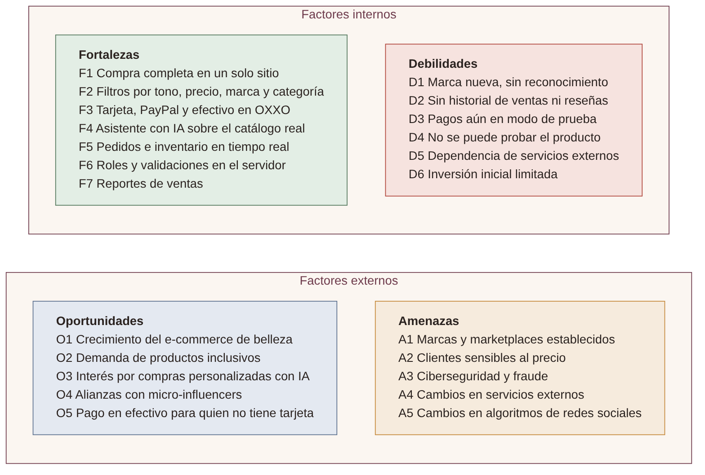

#### Estrategias derivadas del FODA

| Estrategia | Combinación | Acción propuesta |
|---|---|---|
| FO | F2 + O2 | Destacar el filtro por tono como el diferenciador frente a la competencia, en la campaña de lanzamiento. |
| FO | F4 + O3 | Promover el asistente de recomendaciones como parte de la experiencia personalizada. |
| FO | F3 + O5 | Comunicar que se puede pagar en OXXO, para atraer a clientes sin tarjeta. |
| DO | D1 + O4 | Construir reconocimiento de marca con micro-influencers y campañas de bajo costo. |
| DO | D2 + O1 | Generar reseñas y testimonios desde el lanzamiento, aprovechando el crecimiento del e-commerce. |
| FA | F6 + A3 | Mantener la seguridad de los pagos y las sesiones como argumento de confianza. |
| FA | F2 + A1 | Competir por experiencia de elección de tono, no por precio ni por reconocimiento. |
| DA | D5 + A4 | Reducir la dependencia de servicios externos con alternativas y monitoreo de sus cambios. |
| DA | D6 + A2 | Priorizar promociones de bajo costo y programas de fidelización, sin depender de grandes inversiones. |

### 2.7 Mapas del proyecto

Los siguientes mapas representan la estructura, la navegación, los procesos y la experiencia de Nuvé.

#### Mapa del sitio (estructura)

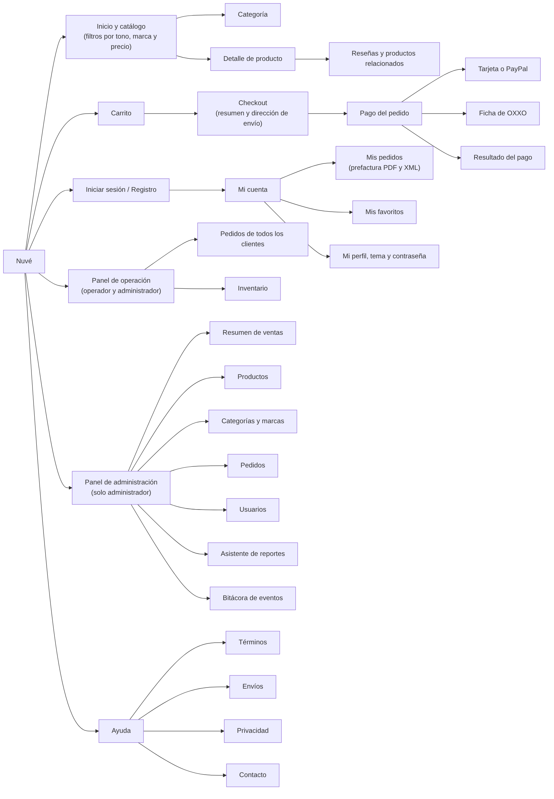

#### Mapa de navegación por rol

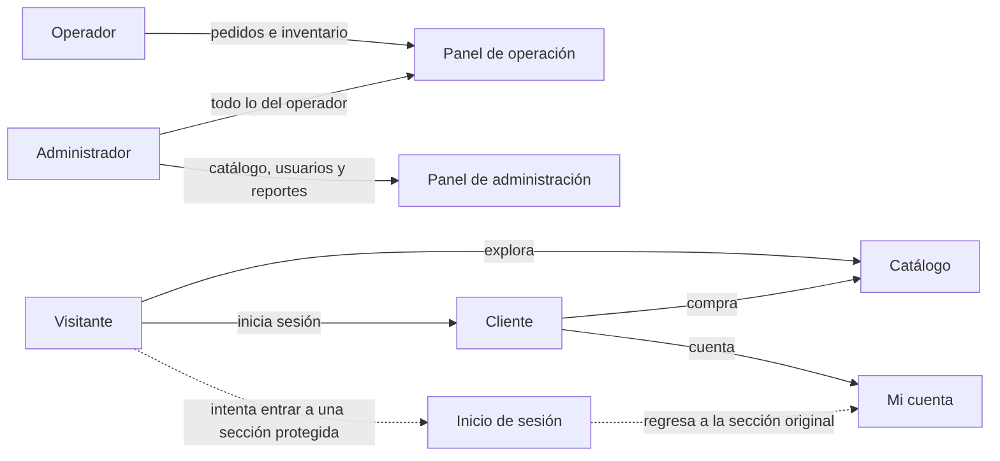

#### Proceso de compra

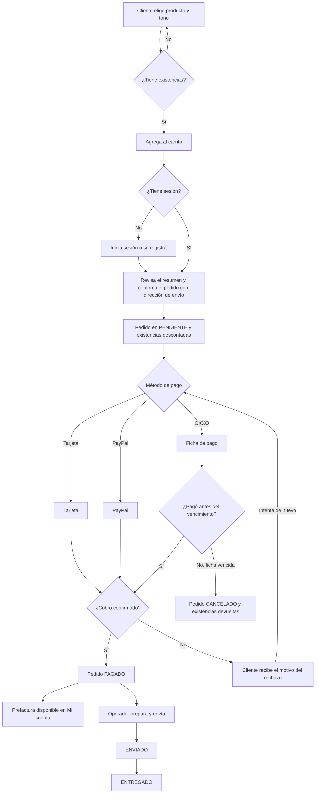

#### Ciclo de vida del pedido

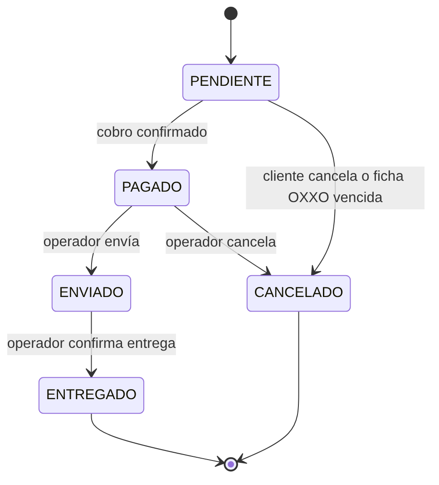

#### Mapa de experiencia del cliente

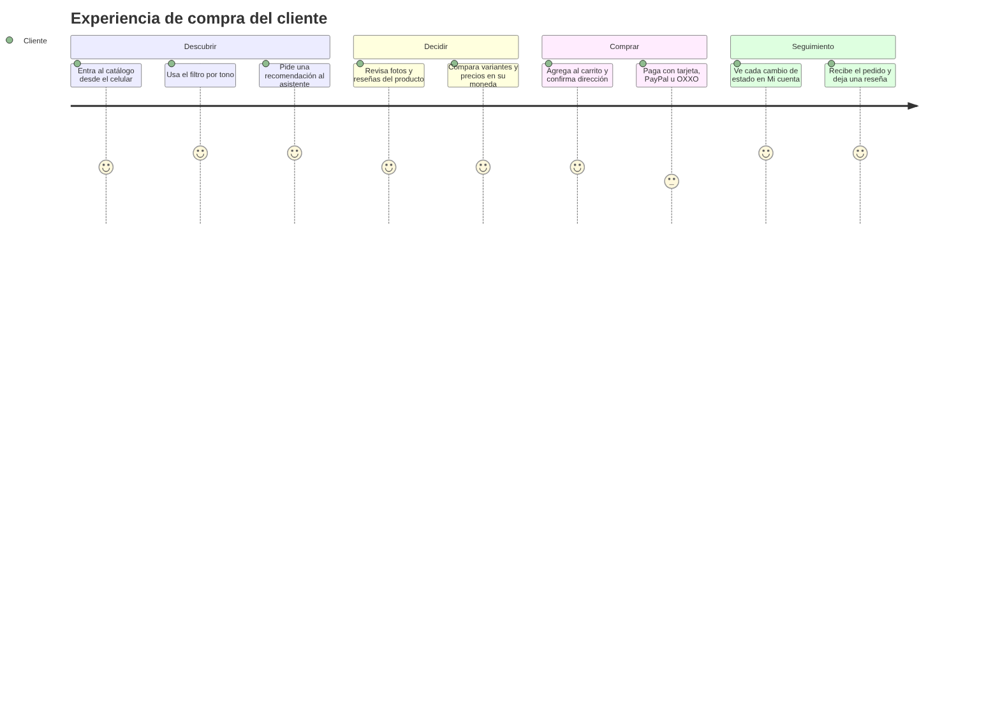

#### Mapa de experiencia del operador

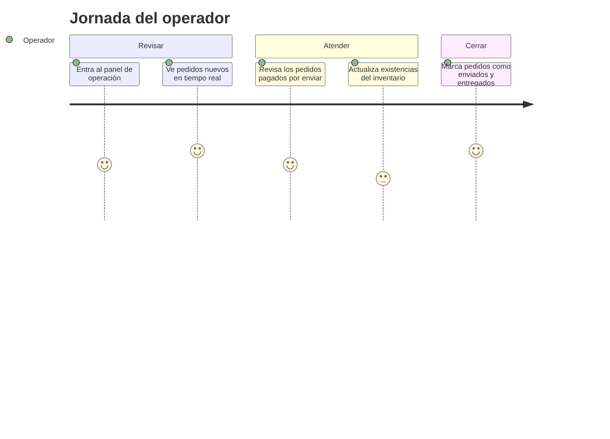


### 2.8 Análisis de mercado

Este apartado investiga el mercado al que se dirige Nuvé: la necesidad que atiende, el público objetivo, la competencia y los canales para dar a conocer la tienda. Se basa en el estudio de viabilidad del proyecto.

#### Necesidad y oportunidad

Las personas que compran maquillaje en línea necesitan encontrar productos de forma sencilla, comparar opciones y reconocer los tonos disponibles antes de hacer un pedido. En algunas plataformas con catálogos muy amplios, la búsqueda resulta poco práctica y la atención no siempre se adapta a las necesidades de cada comprador.

Nuvé responde a esta necesidad con un catálogo organizado, una imagen de marca consistente y un proceso de compra claro. La oportunidad consiste en comenzar con un catálogo manejable y llegar primero a clientes de Guadalajara y su zona metropolitana. Si la respuesta es favorable, el negocio podría ampliar su alcance a otras ciudades de México.

#### Público objetivo

| Segmento | Descripción |
|---|---|
| Público principal | Mujeres de 18 a 35 años que utilizan internet, compran maquillaje y cuentan con medios de pago digitales. |
| Público secundario | Personas que buscan productos de maquillaje para regalar o que están empezando a utilizarlos. |
| Zona inicial | Guadalajara y su zona metropolitana. |
| Posible expansión | Envíos a otras ciudades de México, conforme se definan los procesos de entrega y operación. |

Este público es una primera orientación. Será necesario observar las visitas, las compras y las opiniones de los clientes para confirmar qué segmento responde mejor.

#### Análisis de la competencia

| Tipo de competencia | Ejemplos | Fortalezas | Oportunidad para Nuvé |
|---|---|---|---|
| Tiendas especializadas y departamentales | Sephora y Liverpool | Marcas reconocidas y variedad de productos. | Brindar una experiencia más cercana y presentar una selección concreta. |
| Marketplaces | Mercado Libre y Amazon | Amplio catálogo y distintas opciones de compra. | Mantener una tienda enfocada en maquillaje, con información organizada por producto y tono. |
| Marcas con venta directa | Marcas que venden mediante catálogo o redes sociales | Contacto directo con su comunidad. | Reunir el catálogo, el carrito, el pago y el seguimiento de pedidos en una sola plataforma. |

Nuvé compite con negocios que tienen más reconocimiento y capacidad de distribución. Por eso no conviene competir solo por precio: es importante cuidar la presentación de los productos, la comunicación de la marca y la facilidad de compra.

#### Canales de promoción

- Publicar fotografías, tutoriales y novedades de productos en Instagram y TikTok.
- Buscar colaboraciones con microinfluencers locales cuyo contenido se relacione con el maquillaje.
- Invitar a los visitantes a suscribirse al boletín por correo disponible en la plataforma.
- Mejorar los títulos y las descripciones de productos y categorías para facilitar su localización en buscadores.
- Revisar qué publicaciones y campañas generan más visitas y compras antes de aumentar el presupuesto de publicidad.

#### Conclusión del análisis de mercado

Nuvé tiene una propuesta que puede probarse en un mercado local. Existe competencia considerable, por lo que la aceptación del negocio dependerá de su capacidad para atraer compradores, presentar bien sus productos y brindar una experiencia confiable. Se recomienda comenzar con un catálogo pequeño, medir la respuesta del público y ajustar la oferta con base en los resultados.


### 2.9 Diseño

#### 2.9.1 Brief

| Elemento | Definición |
|---|---|
| Marca | Nuvé · "Belleza que te ilumina" |
| Público | Personas de 18 a 40 años que buscan maquillaje para su tono de piel y compran desde el celular |
| Personalidad | Cálida, cercana e incluyente |
| Colores | Oro Rosa `#BE846A` (acciones principales), Ciruela `#6E3B4C` (encabezados y pie), Beige Tostado `#C9A26B` (secundario), Tinta `#2B2320` (texto), Fondo `#FBF6F1`, Error `#B1473D` |
| Tipografía | Lora (títulos) y Poppins (texto e interfaz) |
| Componentes | Botones redondeados, tarjetas blancas con borde `#E5DAD1`, selector de tonos con círculos de color |
| Modo oscuro | Fondo Ciruela Oscuro `#4F2835` con texto claro (RF1.7) |
| Accesibilidad | Foco visible, texto alternativo en imágenes y estados que no dependen solo del color (RF2.17) |
| Fuente | Manual de Identidad Digital Nuvé, implementado en `front/src/styles/theme.css` |

#### 2.9.2 Wireframes

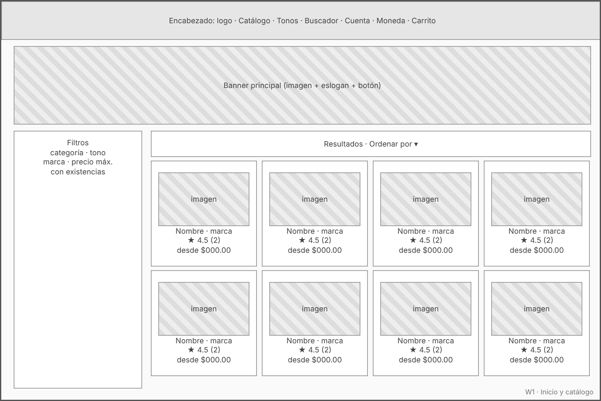

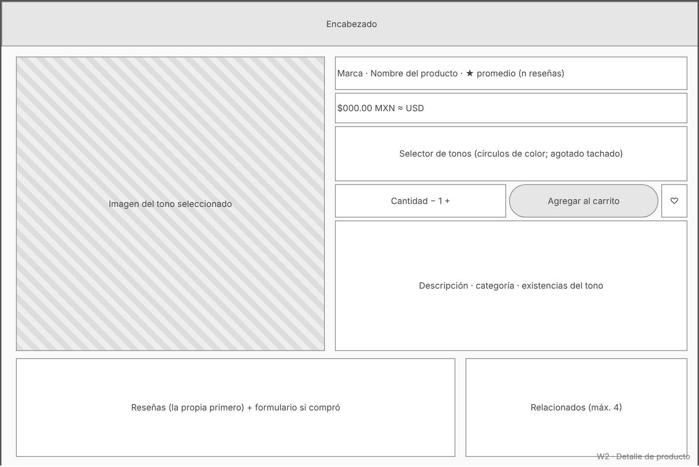

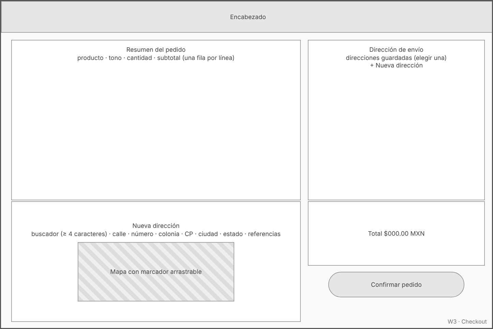

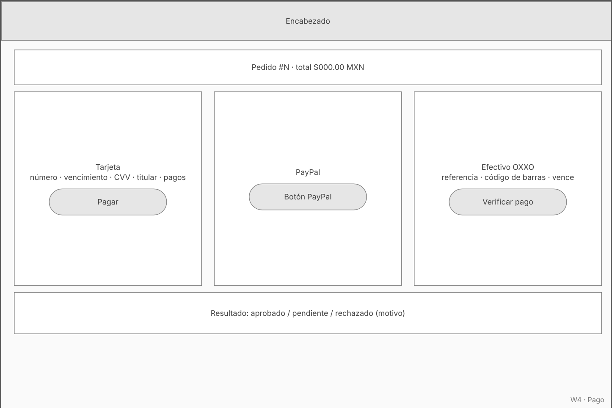

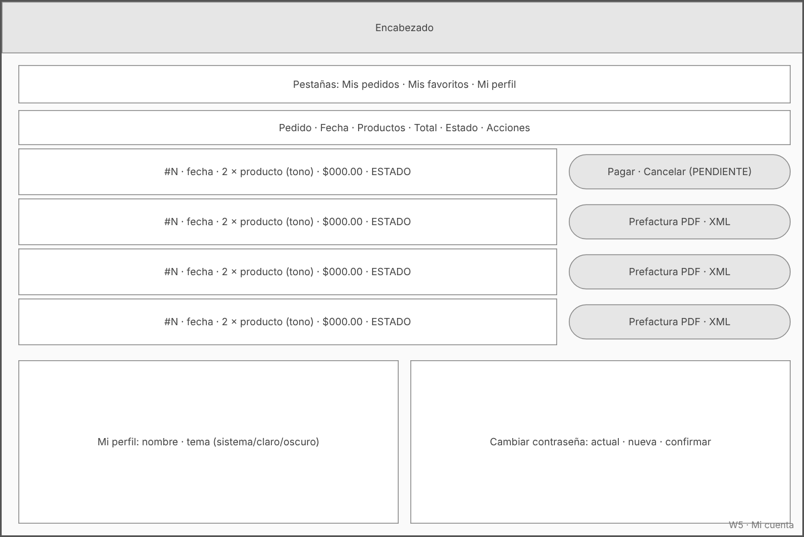

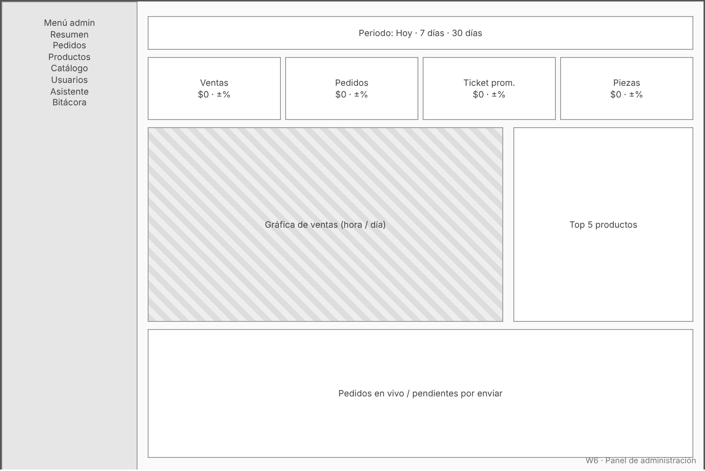

#### 2.9.3 Mockups

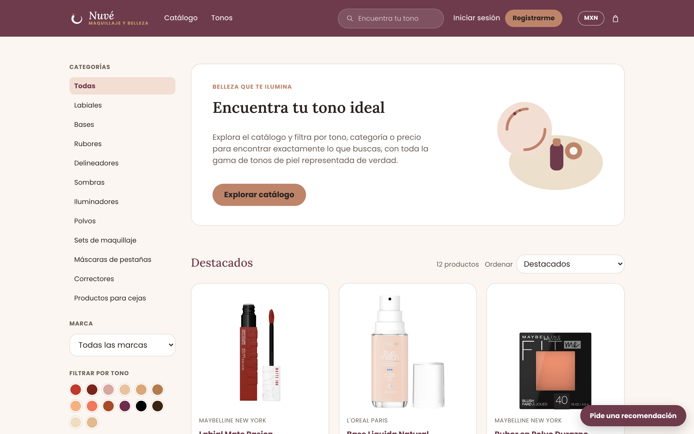

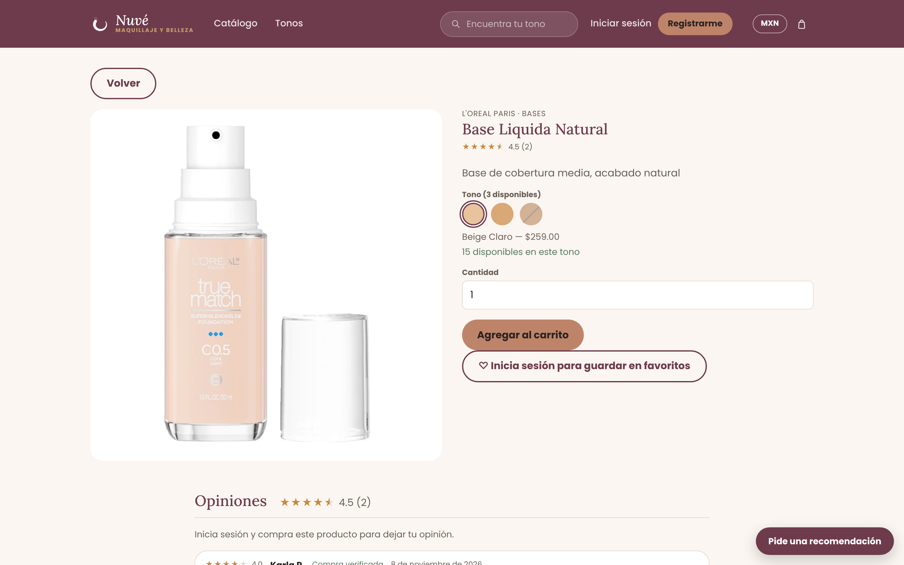

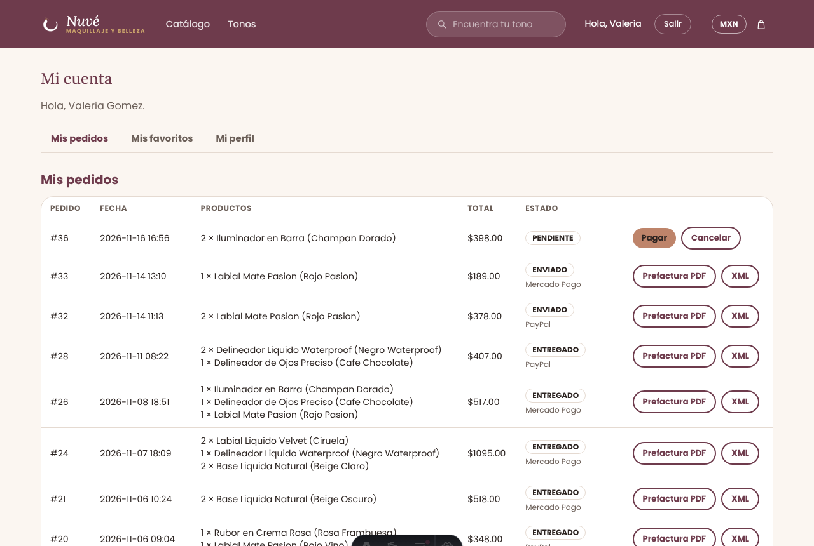

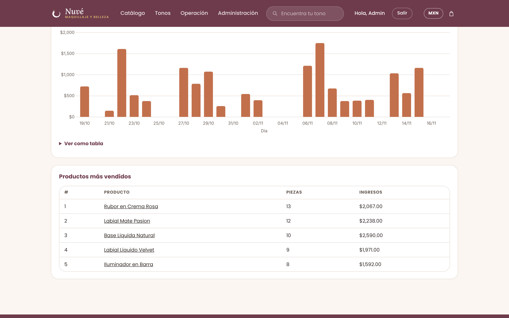

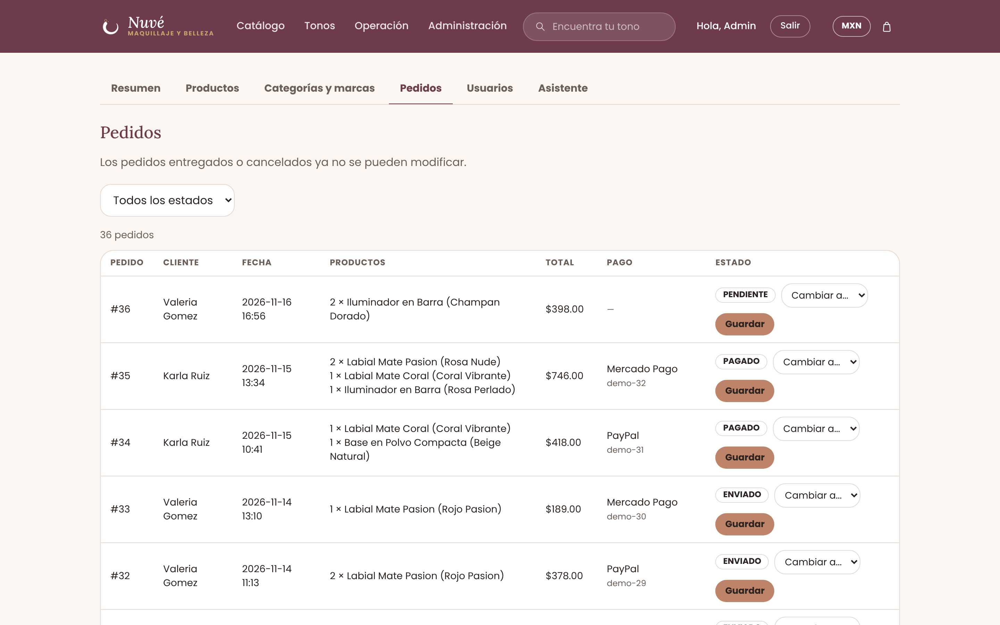

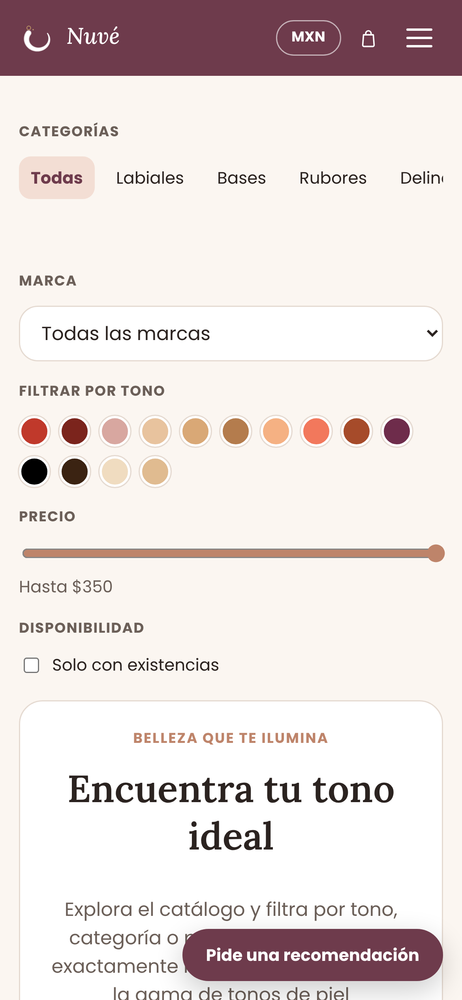

#### 2.9.4 Prototipo

El prototipo navegable es el sitio publicado: https://nuveweb.netlify.app.

## 3. Requisitos Específicos

### 3.1 Requisitos Funcionales

Cada requisito describe una sola capacidad del sistema sin indicar la tecnología con que se construye (la tecnología se describe en la sección 5). El **criterio de aceptación** indica qué se observa para darlo por cumplido y la columna **Verificación** indica cómo se comprueba: *prueba automatizada* (PA, se ejecuta con `npm test` y en el pipeline de CI), *prueba manual* (PM, caso de `docs/PRUEBAS.md`), *inspección* (revisión del archivo indicado en la matriz de trazabilidad) o *demostración* (se ejecuta el criterio en el sitio publicado).

#### 3.1.1 Gestión de Usuarios

| ID | Requisito | Criterio de aceptación | Verificación |
|--|--------|-------|---|
| RF1.1 | El sistema permite al visitante registrarse con nombre, correo electrónico y contraseña. | Al enviar el formulario de /registro con datos válidos se crea la cuenta y queda con la sesión iniciada. | Prueba manual (PM-2) |
| RF1.2 | El sistema asigna el rol CLIENTE a toda cuenta creada mediante el registro público. | La cuenta creada en /registro tiene el rol CLIENTE aunque la petición incluya otro rol. | Prueba manual (PM-2) |
| RF1.3 | El sistema permite al usuario iniciar sesión con su correo electrónico y su contraseña. | Con credenciales correctas, el usuario entra y es dirigido según su rol: administrador a /admin, operador a /operador y cliente a /. | Prueba manual (PM-5) |
| RF1.4 | El sistema permite al usuario cerrar sesión. | Al pulsar "Salir", las cookies de sesión se eliminan y el token de renovación queda revocado. | Prueba manual (PM-16) |
| RF1.5 | El sistema renueva la sesión del usuario sin pedirle sus credenciales mientras su token de renovación sea válido. | Al borrar la cookie de acceso y recargar /mi-cuenta, la página se muestra y se crea una cookie de acceso nueva. | Prueba manual (PM-13) |
| RF1.6 | El sistema permite al usuario con sesión cambiar su nombre en la página de perfil. | En /mi-cuenta/perfil, al guardar un nombre nuevo, el encabezado muestra el nombre nuevo después de recargar. | Demostración |
| RF1.7 | El sistema permite al usuario con sesión elegir su tema de color: sistema, claro u oscuro. | Al elegir "Oscuro" y guardar, la tienda se muestra con fondo oscuro en las siguientes páginas y en un inicio de sesión posterior. | Demostración |
| RF1.8 | El sistema permite al usuario con sesión cambiar su contraseña en la página de perfil, indicando su contraseña actual. | Con la contraseña actual correcta y una nueva válida, el sistema muestra "Tu contraseña se cambió.", conserva la sesión en ese navegador y la contraseña nueva permite iniciar sesión. | Prueba manual (PM-25) |
| RF1.9 | El sistema cierra las demás sesiones abiertas del usuario cuando este cambia su contraseña. | Tras cambiar la contraseña en el navegador A, la sesión abierta en el navegador B pide iniciar sesión al vencer su token de acceso. | Prueba manual (PM-25) |
| RF1.10 | El sistema permite al administrador consultar las cuentas de usuario. | /admin/usuarios lista nombre, correo, rol y estado de cada cuenta. | Demostración |
| RF1.11 | El sistema permite al administrador crear cuentas de cliente, operador o administrador. | La cuenta creada inicia sesión con el rol elegido. | Demostración |
| RF1.12 | El sistema permite al administrador cambiar el rol de una cuenta. | Tras cambiar a OPERADOR, la cuenta entra a /operador. | Prueba manual (PM-11) |
| RF1.13 | El sistema permite al administrador activar y desactivar cuentas. | Una cuenta desactivada no puede iniciar sesión y puede hacerlo al reactivarla. | Prueba manual (PM-12) |
| RF1.14 | El sistema cierra las sesiones de una cuenta cuando el administrador la desactiva. | Los tokens de renovación de la cuenta quedan revocados. | Prueba manual (PM-12) |
| RF1.15 | El sistema permite al administrador eliminar cuentas de usuario. | La cuenta eliminada desaparece de la lista. | Demostración |
| RF1.16 | El sistema maneja tres roles de usuario: cliente, operador y administrador. | La tabla rol contiene CLIENTE, OPERADOR y ADMIN. | Inspección |
| RF1.17 | El sistema permite el panel de operación al operador y al administrador, y el panel de administración solo al administrador. | Un cliente que abre /operador o /admin y un operador que abre /admin ven "Sin permiso". | Prueba manual (PM-8, PM-9) |
| RF1.18 | El sistema redirige al inicio de sesión al usuario sin sesión que abre una sección protegida y, tras iniciar sesión, lo regresa a esa sección. | Sin sesión, /mi-cuenta lleva a /login?next=/mi-cuenta y, al entrar, regresa a /mi-cuenta. | Prueba manual (PM-7) |

#### 3.1.2 Exploración del Catálogo

| ID | Requisito | Criterio de aceptación | Verificación |
|--|--------|-------|---|
| RF2.1 | El sistema muestra los productos activos con nombre, marca, imagen principal y precio mínimo entre sus variantes. | En la página de inicio, cada tarjeta muestra los cuatro datos y no aparece ningún producto desactivado. | Prueba manual (PM-1) |
| RF2.2 | El sistema muestra el detalle de un producto con descripción, categoría, imágenes y sus variantes activas con tono, presentación y precio. | En /producto/{id} aparecen los datos indicados y solo las variantes activas. | Demostración |
| RF2.3 | El sistema permite filtrar el catálogo por tono. | Al elegir un tono, solo se muestran productos con una variante de ese tono. | Prueba manual (PM-36) |
| RF2.4 | El sistema permite filtrar el catálogo por precio máximo. | Con precio máximo $200, ningún producto mostrado tiene precio mínimo mayor a $200. | Prueba manual (PM-36) |
| RF2.5 | El sistema permite buscar productos por nombre o por marca. | Al buscar el nombre de una marca, se muestran los productos de esa marca. | Prueba manual (PM-36) |
| RF2.6 | El sistema muestra los productos de una categoría en su página. | En /categoria/{id} todos los productos pertenecen a esa categoría. | Demostración |
| RF2.7 | El sistema oculta a los clientes los productos y las variantes desactivados. | Un producto desactivado en el panel no aparece en el catálogo y su página no muestra variantes inactivas. | Demostración |
| RF2.8 | El sistema permite filtrar el catálogo por marca. | Al elegir una marca, todos los productos mostrados son de esa marca. | Prueba manual (PM-36) |
| RF2.9 | El sistema permite mostrar solo los productos con al menos una variante con existencias mayores a 0. | Con el filtro activo, ningún producto mostrado tiene todas sus variantes en 0. | Prueba manual (PM-36) |
| RF2.10 | El sistema aplica juntos los filtros de categoría, tono, marca, precio máximo y existencias. | Con dos o más filtros activos, cada producto mostrado cumple todos ellos. | Prueba manual (PM-36) |
| RF2.11 | El sistema permite ordenar los productos por precio mínimo ascendente, precio mínimo descendente, piezas vendidas descendente y calificación promedio descendente. | Con cada orden elegido, la secuencia de productos respeta el criterio indicado. | Prueba manual (PM-36) |
| RF2.12 | El sistema muestra, en el detalle del producto, la imagen, el precio y las existencias del tono que el cliente selecciona. | Al cambiar de tono, cambian la imagen, el precio y las existencias mostradas. | Demostración |
| RF2.13 | El sistema muestra en el detalle del producto y en las tarjetas del catálogo la calificación promedio con 1 decimal y el número de reseñas. | Un producto con reseñas de 5 y 4 muestra "4.5" y "2 reseñas". | Demostración |
| RF2.14 | El sistema muestra en el detalle de un producto hasta 4 productos relacionados: primero los de la misma categoría y después los de la misma marca. | La sección de relacionados tiene como máximo 4 productos y los de la misma categoría aparecen primero. | Prueba manual (PM-43) |
| RF2.15 | El sistema permite elegir una moneda de referencia (USD, EUR, CAD, GBP o COP) y muestra, junto al precio en MXN, el precio aproximado en esa moneda. | Al elegir USD, cada precio muestra además su equivalente aproximado en dólares. | Prueba manual (PM-44) |
| RF2.16 | El sistema organiza los productos en las categorías Bases, Correctores, Polvos, Rubores, Iluminadores, Labiales, Sombras, Máscaras de pestañas, Delineadores, Productos para cejas y Sets de maquillaje. | El menú de categorías muestra las 11 categorías indicadas. | Inspección |
| RF2.17 | El sistema muestra tachado y con el texto "Agotado en este tono" el tono sin existencias, y desactiva para ese tono el botón "Agregar al carrito". | Al seleccionar un tono con 0 existencias, el botón queda desactivado y aparece el texto. | Demostración |
| RF2.18 | El sistema permite al cliente agregar un producto a su lista de favoritos. | Al pulsar el corazón, el producto aparece en /mi-cuenta/favoritos. | Prueba manual (PM-35) |
| RF2.19 | El sistema permite al cliente quitar un producto de su lista de favoritos. | Al volver a pulsar el corazón, el producto desaparece de /mi-cuenta/favoritos. | Prueba manual (PM-35) |
| RF2.20 | El sistema muestra la lista de favoritos del cliente ordenada del agregado más reciente al más antiguo. | El último producto agregado aparece primero. | Prueba manual (PM-35) |
| RF2.21 | El sistema permite al cliente publicar una reseña de un producto con calificación y comentario. | La reseña enviada aparece en el detalle del producto. | Prueba manual (PM-34) |
| RF2.22 | El sistema permite al cliente editar su reseña de un producto. | Tras editar, la reseña muestra la calificación y el comentario nuevos. | Prueba manual (PM-34) |
| RF2.23 | El sistema permite al cliente eliminar su reseña de un producto. | Tras eliminarla, la reseña ya no aparece. | Prueba manual (PM-34) |
| RF2.24 | El sistema muestra las reseñas de un producto con calificación, comentario, fecha, autor y la etiqueta "Compra verificada"; la reseña del propio cliente aparece primero y las demás de la más reciente a la más antigua. | Con sesión de un cliente que reseñó, su reseña es la primera de la lista. | Demostración |
| RF2.25 | El sistema permite al cliente con sesión escribir a la Asesora Nuvé lo que busca y recibir recomendaciones de productos y tonos del catálogo. | Al preguntar "base para piel morena", la respuesta incluye productos del catálogo. | Prueba manual (PM-39) |
| RF2.26 | El sistema muestra cada recomendación con imagen, nombre, tono, marca, precio, motivo y enlace al producto. | Cada tarjeta muestra esos siete elementos y el enlace abre el producto. | Prueba manual (PM-39) |
| RF2.27 | El sistema conserva los últimos 20 mensajes de la Asesora Nuvé al cambiar de página en la misma pestaña y permite borrarlos con "Nueva conversación". | Tras cambiar de página, la conversación sigue; tras "Nueva conversación", queda vacía. | Demostración |

#### 3.1.3 Carrito de Compras

| ID | Requisito | Criterio de aceptación | Verificación |
|--|--------|-------|---|
| RF3.1 | El sistema permite al cliente agregar al carrito una variante de producto con una cantidad. | Tras pulsar "Agregar al carrito", el contador del carrito aumenta en la cantidad elegida. | Demostración |
| RF3.2 | El sistema permite al cliente modificar la cantidad de cada producto del carrito. | En /carrito, al cambiar la cantidad, el subtotal y el total se recalculan. | Demostración |
| RF3.3 | El sistema permite al cliente eliminar un producto del carrito. | Al pulsar "Quitar", el producto desaparece del carrito. | Demostración |
| RF3.4 | El sistema conserva el carrito al navegar entre páginas en el mismo navegador. | Después de agregar un producto y abrir otra página, el carrito conserva el producto. | Demostración |
| RF3.5 | El sistema vacía el carrito al cerrar sesión. | Tras "Salir", el carrito queda vacío. | Prueba manual (PM-16) |
| RF3.6 | El sistema calcula el total del carrito como la suma de cantidad por precio unitario de cada producto. | 2 piezas de $100 y 1 de $50 dan un total de $250.00. | Demostración |

#### 3.1.4 Procesamiento de Pedidos

| ID | Requisito | Criterio de aceptación | Verificación |
|--|--------|-------|---|
| RF4.1 | El sistema permite al cliente registrar, durante el checkout, una dirección de envío con calle, número exterior, colonia, ciudad o municipio, estado, código postal y referencias opcionales. | Al guardar la dirección en /checkout, aparece en la lista de direcciones del cliente. | Prueba automatizada (PA-20); Demostración |
| RF4.2 | El sistema permite al cliente elegir una de sus direcciones guardadas al confirmar un pedido. | El pedido creado queda asociado a la dirección elegida. | Demostración |
| RF4.3 | El sistema sugiere direcciones cuando el cliente escribe al menos 4 caracteres en el buscador y, al elegir una, llena calle, número exterior, colonia, código postal, ciudad o municipio y estado. | Al escribir "Av. Vallarta" y elegir una sugerencia, los campos se llenan. | Prueba manual (PM-45) |
| RF4.4 | El sistema muestra la dirección en un mapa con un marcador arrastrable y guarda la latitud y la longitud del marcador. | Al mover el marcador y guardar, la dirección guardada tiene las coordenadas nuevas. | Prueba manual (PM-45) |
| RF4.5 | El sistema permite al cliente con sesión confirmar un pedido con los productos de su carrito y una dirección de envío. | Al confirmar en /checkout, se crea un pedido que aparece en /mi-cuenta. | Prueba manual (PM-21) |
| RF4.6 | El sistema calcula el precio de cada línea con el precio vigente guardado y el total del pedido como la suma de los subtotales. | Aunque la petición envíe otro precio, el pedido guarda el precio del catálogo. | Prueba manual (PM-20) |
| RF4.7 | El sistema descuenta las existencias de cada producto al crear el pedido. | Un tono con 10 piezas queda en 8 tras un pedido de 2 piezas. | Prueba manual (PM-21) |
| RF4.8 | El sistema registra el pedido nuevo con estado PENDIENTE. | El pedido recién creado aparece como PENDIENTE en /mi-cuenta. | Prueba manual (PM-21) |
| RF4.9 | El sistema permite al cliente consultar su historial de pedidos con productos, total, estado y método de pago. | /mi-cuenta lista los pedidos del cliente con esos cuatro datos. | Demostración |
| RF4.10 | El sistema permite al cliente cancelar uno de sus pedidos. | Al pulsar "Cancelar" en un pedido PENDIENTE, este pasa a CANCELADO. | Prueba manual (PM-21) |
| RF4.11 | El sistema devuelve las existencias de los productos de un pedido cuando este se cancela. | Tras cancelar un pedido de 2 piezas, el tono recupera las 2 piezas. | Prueba manual (PM-21) |
| RF4.12 | El sistema cancela la ficha de pago en efectivo de un pedido cuando el pedido se cancela. | La ficha del pedido cancelado aparece como cancelada en el proveedor de pagos. | Demostración |
| RF4.13 | El sistema muestra al cliente, antes de confirmar, un resumen con nombre, tono, cantidad y subtotal de cada producto, el total en MXN y sus direcciones para elegir una. | /checkout muestra todos esos datos antes del botón de confirmar. | Demostración |
| RF4.14 | El sistema permite al cliente pagar su pedido con tarjeta de crédito o débito. | Con una tarjeta de prueba aprobada, el pedido pasa a PAGADO. | Prueba manual (PM-30) |
| RF4.15 | El sistema permite al cliente pagar su pedido con una cuenta de PayPal. | Con una cuenta de prueba de PayPal, el pedido pasa a PAGADO. | Prueba manual (PM-32) |
| RF4.16 | El sistema permite al cliente pagar su pedido en efectivo en tiendas OXXO mediante una ficha de pago. | Al elegir OXXO, se muestra una ficha para pagar en tienda. | Prueba manual (PM-33) |
| RF4.17 | El sistema genera la ficha de pago en efectivo con referencia, código de barras, enlace y fecha de vencimiento, y la guarda en el pedido. | La ficha muestra los cuatro datos y reabrir el pedido muestra la misma ficha. | Prueba manual (PM-33) |
| RF4.18 | El sistema entrega la misma ficha si el pedido ya tiene una vigente y, si venció, la cancela y genera una nueva. | Pedir la ficha dos veces devuelve la misma referencia. | Prueba manual (PM-33) |
| RF4.19 | El sistema consulta al proveedor de pagos si la ficha fue pagada y, si lo fue, marca el pedido como PAGADO. | Tras el pago simulado, "Verificar pago" cambia el pedido a PAGADO. | Prueba manual (PM-33) |
| RF4.20 | El sistema cancela la ficha de pago en efectivo cuando el pedido se paga con otro método. | Si un pedido con ficha se paga con tarjeta, la ficha queda cancelada. | Demostración |
| RF4.21 | El sistema registra en el pedido el método de pago, el identificador de la transacción y la fecha de pago. | En /admin/pedidos, un pedido pagado muestra los tres datos. | Prueba manual (PM-30) |
| RF4.22 | El sistema informa al cliente si el pago quedó aprobado, pendiente o rechazado y, cuando la tarjeta es rechazada, el motivo. | Con una tarjeta de prueba rechazada, /pago/resultado muestra "rechazado" y el motivo. | Prueba manual (PM-31) |
| RF4.23 | El sistema permite al administrador simular el pago de una ficha de pago en efectivo en el modo de pruebas. | En /admin/pedidos, "Simular pago (pruebas)" deja la ficha como pagada. | Prueba manual (PM-33) |

#### 3.1.5 Prefactura CFDI

| ID | Requisito | Criterio de aceptación | Verificación |
|--|--------|-------|---|
| RF5.1 | El sistema permite al cliente descargar en PDF la prefactura de su pedido en estado PAGADO, ENVIADO o ENTREGADO. | En /mi-cuenta, el botón "Prefactura PDF" descarga el archivo prefactura-NUV-{id}.pdf. | Prueba automatizada (PA-9); Prueba manual (PM-26) |
| RF5.2 | El sistema permite al cliente descargar en XML la prefactura de su pedido en estado PAGADO, ENVIADO o ENTREGADO. | El botón "XML" descarga prefactura-NUV-{id}.xml. | Prueba automatizada (PA-11); Prueba manual (PM-26) |
| RF5.3 | El sistema permite al administrador descargar en PDF y XML la prefactura de cualquier pedido pagado desde el panel de pedidos. | En /admin/pedidos, los enlaces "PDF" y "XML" de un pedido pagado descargan los archivos. | Prueba manual (PM-26) |
| RF5.4 | El sistema incluye en la prefactura serie NUV, folio igual al número de pedido, fecha, lugar de expedición, emisor, receptor, forma y método de pago, moneda, conceptos, subtotal, IVA trasladado y total. | El XML contiene esos atributos y el PDF los muestra. | Prueba automatizada (PA-3, PA-7, PA-8) |
| RF5.5 | El sistema genera un concepto por cada línea del pedido con cantidad, descripción, SKU, valor unitario, importe e IVA. | Un pedido de 2 líneas produce 2 conceptos. | Prueba automatizada (PA-6) |

#### 3.1.6 Gestión de Inventario

| ID | Requisito | Criterio de aceptación | Verificación |
|--|--------|-------|---|
| RF6.1 | El sistema permite al operador y al administrador consultar las variantes con sus existencias. | La pestaña de inventario lista cada variante con sus existencias. | Demostración |
| RF6.2 | El sistema permite al operador y al administrador ajustar las existencias de una variante. | Al guardar 20 en una variante, el detalle del producto muestra 20 piezas. | Demostración |
| RF6.3 | El sistema marca en la lista de productos del administrador con "Agotado" el producto cuyas variantes suman 0 existencias y con "bajo" el que suma menos de 5. | Un producto con 3 piezas en total muestra "bajo". | Demostración |
| RF6.4 | El sistema avisa al operador y al administrador cuando cambian las existencias o los productos. | Con /operador abierto, un ajuste hecho en otra ventana se refleja sin recargar. | Prueba manual (PM-38) |

#### 3.1.7 Panel Administrativo

| ID | Requisito | Criterio de aceptación | Verificación |
|--|--------|-------|---|
| RF7.1 | El sistema permite al administrador crear un producto con nombre, descripción, categoría, marca, variantes e imágenes en una sola operación. | Al guardar el formulario de /admin/productos/nuevo, el producto aparece en el catálogo con todas sus variantes. | Prueba automatizada (PA-17); Demostración |
| RF7.2 | El sistema permite al administrador editar todos los datos de un producto en una sola operación. | Al cambiar el nombre y una variante y guardar, ambos cambios se ven en la tienda. | Demostración |
| RF7.3 | El sistema permite al administrador desactivar y reactivar un producto. | Un producto desactivado deja de verse en la tienda y vuelve a verse al reactivarlo. | Demostración |
| RF7.4 | El sistema permite al administrador eliminar un producto. | Tras eliminarlo, el producto no aparece en /admin/productos. | Demostración |
| RF7.5 | El sistema permite al administrador agregar una marca. | La marca agregada en /admin/catalogo aparece en la lista de marcas. | Demostración |
| RF7.6 | El sistema permite al administrador editar el nombre y la descripción de una marca. | El nombre editado se muestra en la lista y en los productos de esa marca. | Demostración |
| RF7.7 | El sistema permite al administrador eliminar una marca. | La marca eliminada desaparece de la lista de marcas. | Demostración |
| RF7.8 | El sistema permite al administrador agregar una categoría. | La categoría agregada en /admin/catalogo aparece en el menú de la tienda. | Prueba automatizada (PA-13); Demostración |
| RF7.9 | El sistema permite al administrador editar el nombre y la descripción de una categoría. | El nombre editado se muestra en el menú de la tienda. | Demostración |
| RF7.10 | El sistema permite al administrador eliminar una categoría. | La categoría eliminada desaparece de la lista de categorías. | Demostración |
| RF7.11 | El sistema permite al administrador definir el precio y las existencias de cada variante. | El precio y las existencias guardados se muestran en el detalle del producto. | Demostración |
| RF7.12 | El sistema permite al administrador activar y desactivar una categoría. | Una categoría desactivada deja de aparecer en el menú de la tienda y vuelve a aparecer al activarla. | Demostración |
| RF7.13 | El sistema permite al administrador activar y desactivar una marca. | Una marca desactivada deja de ofrecerse en el formulario de producto y vuelve a ofrecerse al activarla. | Demostración |
| RF7.14 | El sistema permite al administrador asignar, de forma opcional, una imagen a cada variante. | Al seleccionar ese tono en la tienda, se ve la imagen asignada. | Demostración |
| RF7.15 | El sistema permite al administrador subir un archivo de imagen desde el formulario del producto y guarda la dirección (URL) resultante en el campo de imagen correspondiente. | Tras elegir un archivo, el campo se llena con una URL y la vista previa muestra la imagen. | Prueba manual (PM-42) |
| RF7.16 | El sistema permite al operador y al administrador consultar los pedidos de todos los clientes. | /operador lista pedidos de distintos clientes. | Prueba manual (PM-9) |
| RF7.17 | El sistema permite al operador y al administrador cambiar el estado de un pedido según las transiciones permitidas. | Un pedido PAGADO cambia a ENVIADO desde /operador. | Prueba automatizada (PA-14); Demostración |
| RF7.18 | El sistema permite al administrador consultar el resumen de ventas del día, de los últimos 7 días o de los últimos 30 días. | Al cambiar el periodo en /admin, las cifras se recalculan. | Prueba manual (PM-37) |
| RF7.19 | El sistema muestra ventas totales, número de pedidos, ticket promedio, piezas vendidas y su comparación contra el periodo anterior. | /admin muestra los cinco indicadores. | Prueba manual (PM-37) |
| RF7.20 | El sistema muestra una gráfica de ventas agrupadas por hora en el periodo del día y por día en los periodos de 7 y 30 días. | En "Hoy" la gráfica tiene 24 puntos; en "30 días", 30. | Prueba manual (PM-37) |
| RF7.21 | El sistema muestra los 5 productos más vendidos del periodo con sus piezas e ingresos. | La tabla tiene como máximo 5 filas ordenadas por piezas. | Prueba manual (PM-37) |
| RF7.22 | El sistema muestra la cantidad de pedidos PENDIENTE y la de pedidos PAGADO por enviar. | Los contadores coinciden con /admin/pedidos filtrado por estado. | Demostración |
| RF7.23 | El sistema avisa al operador y al administrador cuando se crea un pedido. | Con /operador abierto, un pedido nuevo aparece sin recargar. | Prueba manual (PM-38) |
| RF7.24 | El sistema avisa al operador, al administrador y al cliente dueño cuando cambia el estado, el pago o la ficha de pago de un pedido. | Con /mi-cuenta abierto, el cliente ve el estado nuevo sin recargar. | Prueba manual (PM-38) |
| RF7.25 | El sistema actualiza las listas de pedidos e inventario sin recargar la página. | La página no se recarga al recibir un aviso. | Prueba manual (PM-38) |
| RF7.26 | El sistema registra en una bitácora los eventos de inicio de sesión exitoso y fallido, registro de cuenta, cambio de contraseña, creación, pago, cambio de estado y cancelación de pedidos, ajuste de inventario, guardado de producto y generación de prefactura. | Tras un inicio de sesión fallido, la bitácora muestra un evento SESION_FALLIDA. | Prueba automatizada (PA-2); Prueba manual (PM-28) |
| RF7.27 | El sistema permite al administrador consultar los 100 eventos más recientes de la bitácora con fecha, tipo, usuario, pedido y detalle. | /admin/bitacora muestra una tabla con esas cinco columnas, del más reciente al más antiguo. | Prueba manual (PM-28) |
| RF7.28 | El sistema permite al administrador filtrar la bitácora por tipo de evento. | Al elegir PEDIDO_CREADO, todas las filas son de ese tipo. | Prueba manual (PM-28) |
| RF7.29 | El sistema permite al administrador preguntar al asistente de reportes sobre ventas, inventario y pedidos y recibir respuestas con los datos de la tienda. | Al preguntar "¿qué se vendió más esta semana?", la respuesta coincide con el reporte de 7 días. | Demostración |

#### 3.1.8 API GraphQL + MCP

| ID | Requisito | Criterio de aceptación | Verificación |
|--|--------|-------|---|
| RF8.1 | El sistema ofrece una interfaz de programación (API) de datos con un único punto de entrada y un esquema que documenta sus tipos, consultas y operaciones. | Una consulta de introspección a la ruta /graphql del backend publicado devuelve el esquema completo. | Prueba automatizada (PA-10); Inspección |
| RF8.2 | El sistema permite a un asistente de IA externo buscar productos, ver el detalle de un producto y consultar las variantes con existencias menores o iguales a un límite (5 por defecto). | Desde Claude Desktop, la herramienta stock_bajo devuelve solo variantes con 5 piezas o menos. | Prueba manual (PM-40) |
| RF8.3 | El sistema permite a un asistente de IA externo consultar el resumen de ventas, la lista de pedidos, el detalle de un pedido y los pedidos propios. | La herramienta listar_pedidos devuelve los mismos pedidos que /admin/pedidos. | Prueba manual (PM-40) |
| RF8.4 | El sistema permite a un asistente de IA externo cambiar el estado de un pedido y actualizar las existencias de una variante. | Tras actualizar_existencias, el inventario muestra el valor nuevo. | Prueba manual (PM-40) |
| RF8.5 | El sistema ofrece al asistente externo el catálogo y las páginas de ayuda como recursos de solo lectura. | Claude Desktop lista los recursos de catálogo y ayuda. | Demostración |

#### 3.1.9 Integración y Despliegue Continuo

| ID | Requisito | Criterio de aceptación | Verificación |
|--|--------|-------|---|
| RF9.1 | El sistema cuenta con un proceso automático que, en cada envío al repositorio, analiza el código, prepara una base de datos de prueba, ejecuta las pruebas automatizadas y compila el frontend. | Cada push muestra en la pestaña Actions de GitHub una ejecución "CI" con los trabajos backend, frontend y mcp. | Inspección |
| RF9.2 | El sistema se despliega automáticamente en producción cuando el proceso de integración termina sin errores en la rama principal, y comprueba que el sitio y la API respondan. | Tras una ejecución "CI" exitosa en main, la ejecución "CD" dispara el despliegue y sus dos comprobaciones terminan en verde. | Inspección |

#### 3.1.10 Ayuda y Privacidad

| ID | Requisito | Criterio de aceptación | Verificación |
|--|--------|-------|---|
| RF10.1 | El sistema muestra las páginas de ayuda de términos, envíos, privacidad y contacto. | Las cuatro páginas de /ayuda abren desde el pie de página. | Demostración |
| RF10.2 | El sistema muestra, la primera vez que el usuario entra a la tienda, un aviso de cookies con un enlace al aviso de privacidad y un botón "Entendido" que oculta el aviso en ese navegador. | El aviso aparece en una ventana privada nueva y, tras "Entendido", no vuelve a aparecer al recargar. | Prueba manual (PM-41) |
| RF10.3 | El sistema incluye en el aviso de privacidad un apartado que indica qué cookies y datos del navegador usa, para qué, cuánto duran y cómo borrarlos o bloquearlos. | La página /ayuda/privacidad contiene el apartado "Cookies". | Inspección |

### 3.2 Requisitos No Funcionales

Cada requisito no funcional es una restricción medible e indica en la columna **Aplica a** los requisitos funcionales que restringe.

#### 3.2.1 Rendimiento

| ID | Requisito | Aplica a | Criterio de aceptación | Verificación |
|--|-------|--|------|---|
| RNF1.1 | El sistema reutiliza los tipos de cambio obtenidos durante 6 horas y, si el servicio de tipo de cambio no responde, usa las últimas tasas obtenidas. | RF2.15 | Dos consultas dentro de 6 horas hacen una sola petición al servicio externo. | Inspección |
| RNF1.2 | El sistema espera la respuesta del servicio de IA un máximo de 60 segundos y, si no llega, muestra un mensaje de error. | RF2.25, RF7.29 | Con el servicio sin responder, a los 60 s aparece el mensaje. | Inspección |

#### 3.2.2 Seguridad

| ID | Requisito | Aplica a | Criterio de aceptación | Verificación |
|--|-------|--|------|---|
| RNF2.1 | El sistema almacena las contraseñas transformadas con una función de hash de un solo sentido con sal y nunca las devuelve. | RF1.1, RF1.8 | La columna de contraseña de la tabla usuario no contiene el texto original y la API no tiene ningún campo que la devuelva. | Prueba manual (PM-22); Inspección |
| RNF2.2 | El sistema responde "Correo o contraseña incorrectos." ante cualquier inicio de sesión fallido, sin indicar si el correo existe. | RF1.3 | Un correo inexistente y una contraseña incorrecta producen exactamente el mismo mensaje. | Prueba manual (PM-4) |
| RNF2.3 | El sistema rechaza el inicio de sesión de una cuenta desactivada. | RF1.3 | Tras desactivar una cuenta en /admin/usuarios, su inicio de sesión se rechaza. | Prueba manual (PM-12) |
| RNF2.4 | El sistema caduca la credencial de acceso de la sesión a los 15 minutos de emitida. | RF1.3, RF1.5 | Una credencial de acceso con más de 15 minutos o con la firma alterada se rechaza. | Prueba automatizada (PA-23) |
| RNF2.5 | El sistema emite una credencial de renovación aleatoria de 96 caracteres, válida por 7 días y de un solo uso, y guarda solo su huella (hash). | RF1.5 | La credencial mide 96 caracteres y la base de datos guarda su hash, no su valor; una credencial alterada cierra la sesión. | Prueba automatizada (PA-25); Prueba manual (PM-14, PM-15) |
| RNF2.6 | El sistema revoca todas las sesiones del usuario cuando se reutiliza una credencial de renovación usada hace más de 10 segundos. | RF1.5 | Al usar dos veces la misma credencial con 11 segundos de diferencia, todas las sesiones del usuario quedan revocadas. | Prueba manual (PM-15) |
| RNF2.7 | El sistema guarda las credenciales de sesión en cookies inaccesibles para los scripts del navegador y que no se envían en peticiones iniciadas desde otros sitios. | RF1.3 | En las herramientas del navegador, las cookies nuve_access y nuve_refresh aparecen marcadas como HttpOnly y SameSite=Lax. | Prueba manual (PM-6) |
| RNF2.8 | El sistema exige superar una verificación anti-bots en los formularios de inicio de sesión y de registro. | RF1.3, RF1.1 | Si la verificación no se completa o el servicio la rechaza, el formulario no se procesa y se muestra un mensaje. | Demostración |
| RNF2.9 | El sistema cobra siempre el total del pedido guardado y nunca un monto enviado por el navegador. | RF4.14, RF4.15, RF4.16 | Al alterar el monto en la petición, el cobro se hace por el total guardado. | Inspección |
| RNF2.10 | El sistema permite pagar un pedido solo a su dueño y solo en estado PENDIENTE. | RF4.14, RF4.15, RF4.16 | Pagar un pedido ajeno o ya PAGADO devuelve error. | Prueba manual (PM-17) |
| RNF2.11 | El sistema no almacena los datos de la tarjeta bancaria; el proveedor los convierte en un token de un solo uso en el navegador. | RF4.14 | Ninguna tabla de la base de datos tiene columnas de número de tarjeta, vencimiento o código de seguridad. | Inspección |
| RNF2.12 | El sistema envía una llave única por intento de cobro con tarjeta para que el proveedor no procese dos veces el mismo cobro. | RF4.14 | Cada petición de cobro incluye una llave de idempotencia distinta. | Inspección |
| RNF2.13 | El sistema lee las credenciales de los proveedores de pago solo de variables de entorno del servidor. | RF4.14, RF4.15, RF4.16 | El repositorio no contiene credenciales y .env está en .gitignore. | Inspección |
| RNF2.14 | El sistema habilita la simulación de pago en efectivo solo para el administrador y solo cuando el modo de simulación está activado en la configuración del servidor. | RF4.23 | Con OXXO_SIMULAR=false, el botón no aparece y la API rechaza la simulación. | Inspección |
| RNF2.15 | El sistema permite al cliente consultar y modificar solo sus propios favoritos y reseñas. | RF2.18, RF2.22, RF2.23 | Editar la reseña de otro cliente devuelve error. | Inspección |
| RNF2.16 | El sistema impide al administrador cambiar su propio rol, desactivar su propia cuenta o eliminarla. | RF1.12, RF1.13, RF1.15 | Las tres acciones sobre la propia cuenta devuelven error. | Prueba manual (PM-11) |
| RNF2.17 | El sistema exige un mínimo de 8 caracteres en la contraseña de una cuenta creada por el administrador y la almacena transformada con hash. | RF1.11 | Una contraseña de 7 caracteres se rechaza. | Demostración |
| RNF2.18 | El sistema no expone la contraseña de ningún usuario en sus consultas. | RF1.10 | Consultar { usuarios { password } } devuelve error de validación. | Prueba automatizada (PA-10); Prueba manual (PM-22) |
| RNF2.19 | El sistema abre el canal de tiempo real solo con un ticket de 60 segundos que no sirve como credencial de acceso. | RF7.23, RF7.24, RF6.4 | Usar el ticket como credencial de acceso devuelve error. | Prueba automatizada (PA-24) |
| RNF2.20 | El sistema envía al cliente solo los avisos de sus propios pedidos. | RF7.24 | Un cliente no recibe avisos de pedidos ajenos. | Inspección |
| RNF2.21 | El sistema envía al servicio de IA solo datos del catálogo y cifras agregadas de ventas, nunca nombres, correos ni direcciones de clientes. | RF2.25, RF7.29 | El texto enviado al servicio no contiene datos personales. | Inspección |
| RNF2.22 | El sistema permite a cada usuario un máximo de 20 preguntas por hora en cada asistente y, al superarlo, le indica los minutos que faltan. | RF2.25, RF7.29 | La pregunta 21 en una hora muestra el tiempo de espera. | Prueba manual (PM-39) |
| RNF2.23 | El servidor de herramientas inicia sesión con una cuenta de la tienda y respeta los permisos del rol de esa cuenta. | RF8.4 | Con una cuenta CLIENTE, cambiar el estado de un pedido devuelve "Sin permiso". | Prueba manual (PM-40) |
| RNF2.24 | El servidor de herramientas lee el correo y la contraseña de la cuenta desde un archivo local que no se sube al repositorio. | RF8.2 | mcp/.env está en .gitignore. | Inspección |
| RNF2.25 | El sistema autoriza cada subida de imagen con una firma generada en el servidor, sin exponer la llave secreta en el navegador. | RF7.15 | El código del navegador no contiene la llave secreta. | Inspección |
| RNF2.26 | El sistema entrega la prefactura solo al dueño del pedido, al operador o al administrador. | RF5.1, RF5.2 | Un cliente que pide la prefactura de un pedido ajeno recibe "Ese registro no es tuyo." | Prueba manual (PM-27) |
| RNF2.27 | El sistema permite consultar la bitácora solo al administrador. | RF7.27 | Con sesión de operador, /admin/bitacora devuelve "Sin permiso". | Prueba manual (PM-29) |
| RNF2.28 | El sistema no guarda en la bitácora contraseñas, credenciales de sesión ni datos de tarjeta. | RF7.26 | Ningún evento contiene esos datos. | Inspección |
| RNF2.29 | El sistema rechaza un pedido cuya dirección pertenece a otro usuario. | RF4.5 | crearPedido con la dirección 1 usando la sesión de Karla se rechaza. | Prueba manual (PM-19) |
| RNF2.30 | El sistema permite al cliente cancelar solo sus propios pedidos y solo en estado PENDIENTE. | RF4.10 | El botón "Cancelar" no aparece en un pedido PAGADO y la API rechaza cancelar un pedido ajeno. | Prueba manual (PM-17, PM-21) |
| RNF2.31 | El sistema verifica que el cobro de PayPal sea en MXN y que la orden corresponda a un pedido del cliente, y no cobra si el pedido ya no está PENDIENTE. | RF4.15 | Capturar una orden de un pedido CANCELADO devuelve error. | Inspección |
| RNF2.32 | El sistema permite a un cliente consultar y modificar solo sus propios pedidos, direcciones, carrito y favoritos. | RF1.16 | Consultar el pedido de otro cliente devuelve "Ese registro no es tuyo." | Prueba manual (PM-17, PM-18) |
| RNF2.33 | El sistema valida los permisos de cada operación en el servidor de la API, además de las restricciones de las páginas. | RF1.16, RF1.17 | Un operador que llama eliminarProducto directamente a la API recibe FORBIDDEN. | Prueba manual (PM-10) |
| RNF2.34 | El sistema acepta como destino posterior al inicio de sesión solo rutas internas del propio sitio. | RF1.18 | /login?next=https://malo.com redirige según el rol y no al sitio externo. | Prueba manual (PM-24) |
| RNF2.35 | El sistema rechaza los formularios enviados desde otro origen. | RF1.3 | Un POST a /api/auth/login con Origin de otro sitio recibe 403. | Prueba manual (PM-23) |
| RNF2.36 | El navegador no se comunica directamente con la API de datos, salvo el canal de tiempo real. | RF8.1 | En las herramientas de red del navegador, ninguna petición va al dominio del backend salvo la conexión de tiempo real. | Inspección |
| RNF2.37 | El sistema indica al navegador que envíe las cookies de sesión solo por conexiones cifradas (HTTPS) cuando el sitio se sirve por HTTPS. | RF1.3 | En el sitio publicado, las cookies de sesión tienen el atributo Secure. | Inspección |
| RNF2.38 | El sistema lee todas las llaves de servicios externos desde variables de entorno que no se suben al repositorio. | RF7.15, RF2.25 | El repositorio no contiene llaves y los archivos .env están en .gitignore. | Inspección |
| RNF2.39 | El sistema usa solo cookies y almacenamiento del navegador necesarios para la sesión, el carrito, la moneda elegida, el aviso de cookies y los pagos, sin cookies de publicidad, analítica ni rastreo. | RF10.3 | La lista de cookies y almacenamiento del navegador coincide con la del aviso de privacidad. | Inspección |

#### 3.2.3 Usabilidad

| ID | Requisito | Aplica a | Criterio de aceptación | Verificación |
|--|-------|--|------|---|
| RNF3.1 | El sistema permite consultar el catálogo sin iniciar sesión. | RF2.1, RF2.2 | Sin sesión, la página de inicio y el detalle de producto se muestran sin redirigir. | Prueba manual (PM-1) |
| RNF3.2 | El sistema muestra los precios en pesos mexicanos con 2 decimales. | RF2.1, RF2.2 | Un precio de 189 se muestra como "$189.00". | Demostración |
| RNF3.3 | El sistema muestra la imagen principal del producto cuando el tono elegido no tiene imagen propia. | RF2.12 | Al elegir un tono sin imagen, se ve la imagen principal. | Demostración |
| RNF3.4 | El sistema muestra el aviso "Últimas N piezas en este tono" cuando el tono seleccionado tiene 5 piezas o menos. | RF2.12 | Un tono con 3 piezas muestra "Últimas 3 piezas en este tono"; uno con 6 no muestra aviso. | Demostración |
| RNF3.5 | El sistema limita la cantidad elegible en el detalle del producto a las existencias del tono seleccionado. | RF2.12 | Con 4 piezas en existencia, el selector de cantidad no permite elegir 5. | Demostración |
| RNF3.6 | El sistema usa los precios en otras monedas solo como referencia y cobra siempre en MXN. | RF2.15 | Con USD elegido, el pago se registra en MXN. | Demostración |
| RNF3.7 | El sistema muestra al autor de la reseña con la primera palabra de su nombre y la inicial de la segunda, sin su correo. | RF2.24 | "Valeria Gómez" se muestra como "Valeria G.". | Prueba automatizada (PA-22) |
| RNF3.8 | El sistema no muestra en la lista de favoritos los productos desactivados. | RF2.20 | Un producto desactivado desaparece de /mi-cuenta/favoritos. | Demostración |
| RNF3.9 | El sistema no muestra en la tienda las categorías desactivadas ni ofrece en el formulario de producto marcas o categorías desactivadas, salvo la que el producto ya tiene. | RF7.12, RF7.13 | Una marca desactivada no aparece en el selector al crear un producto. | Demostración |
| RNF3.10 | El sistema se adapta a pantallas de 360 px de ancho en adelante sin desplazamiento horizontal. | RF2.1, RF4.5 | En un celular de 360 px, inicio, producto, carrito y checkout se usan sin desplazamiento horizontal. | Demostración |
| RNF3.11 | El sistema no muestra al usuario rutas internas de archivos ni trazas de error. | RF8.1 | Ante un error de la API, la página muestra solo un mensaje en español. | Inspección |
| RNF3.12 | El sistema pospone la actualización de un bloque que el usuario esté usando o haya tocado hace menos de 15 segundos. | RF7.25 | Mientras se escribe en un campo de existencias, el bloque no se reemplaza. | Demostración |
| RNF3.13 | El sistema limita las sugerencias de direcciones al territorio de México. | RF4.3 | Al escribir "Madrid", ninguna sugerencia es de fuera de México. | Prueba manual (PM-45) |
| RNF3.14 | El sistema elimina los espacios al inicio y al final del correo y lo convierte a minúsculas antes de guardarlo o compararlo. | RF1.1, RF1.3 | Una cuenta registrada como "`Ana@Correo.com` " inicia sesión escribiendo "`ana@correo.com`". | Demostración |
| RNF3.15 | El sistema incluye como relacionados solo productos activos, distintos al consultado y con al menos una variante activa con existencias mayores a 0. | RF2.14 | Un producto agotado o desactivado no aparece en la sección de relacionados. | Prueba manual (PM-43) |
| RNF3.16 | El sistema indica en el PDF que la prefactura no está timbrada y no tiene validez fiscal. | RF5.1 | El PDF muestra la leyenda "Sin validez fiscal". | Prueba automatizada (PA-9); Prueba manual (PM-26) |

#### 3.2.4 Mantenibilidad

| ID | Requisito | Aplica a | Criterio de aceptación | Verificación |
|--|-------|--|------|---|
| RNF4.1 | El código del backend no presenta errores en el análisis estático configurado en el repositorio. | RF9.1 | El comando npm run lint en back/ termina sin errores, localmente y en el pipeline. | Inspección |
| RNF4.2 | El sistema ejecuta el análisis de código y las pruebas automatizadas en cada envío al repositorio y despliega solo si pasan. | RF9.1, RF9.2 | Un push a main con una prueba fallida no dispara el despliegue. | Inspección |
| RNF4.3 | El sistema define los permisos de todas las operaciones de la API en un solo archivo. | RF8.1, RF1.16 | Cada operación del esquema aparece en el archivo de permisos con los roles que la pueden usar. | Inspección |
| RNF4.4 | Cada archivo de código inicia con un comentario que indica su ruta y su propósito. | RF8.1 | Al abrir cualquier archivo de back/src o front/src, las primeras líneas describen qué hace. | Inspección |

#### 3.2.5 Escalabilidad

| ID | Requisito | Aplica a | Criterio de aceptación | Verificación |
|--|-------|--|------|---|
| RNF5.1 | El sistema separa frontend, backend, base de datos transaccional y base de documentos en servicios que se despliegan y escalan de forma independiente. | RF8.1, RF9.2 | Cada parte tiene su propio servicio de hospedaje y sus propias variables de configuración, y se puede redesplegar una sin redesplegar las demás. | Inspección |

#### 3.2.6 Disponibilidad y Observabilidad

| ID | Requisito | Aplica a | Criterio de aceptación | Verificación |
|--|-------|--|------|---|
| RNF6.1 | El sistema completa la operación del usuario aunque la bitácora no esté disponible. | RF7.26, RF7.27 | Sin base de documentos configurada, iniciar sesión y comprar funcionan y la página de bitácora avisa que no está disponible. | Prueba automatizada (PA-1) |
| RNF6.2 | El sistema guarda la bitácora en una base de datos de documentos separada de la base de datos de la tienda. | RF7.26 | Los eventos se consultan en la colección bitacora y no existe tabla bitacora en la base relacional. | Prueba automatizada (PA-2); Inspección |
| RNF6.3 | El sistema reintenta la conexión de tiempo real con un ticket nuevo cuando se interrumpe. | RF7.25 | Al reiniciar el servidor, el panel vuelve a recibir avisos sin recargar. | Demostración |
| RNF6.4 | El proceso de despliegue comprueba, al terminar, que la API y el sitio publicados respondan. | RF9.2 | La ejecución "CD" falla si la API o el sitio no responden después del despliegue. | Inspección |

#### 3.2.7 Integridad y Validación de Datos

| ID | Requisito | Aplica a | Criterio de aceptación | Verificación |
|--|-------|--|------|---|
| RNF7.1 | El sistema rechaza el registro cuando el nombre está vacío o contiene solo espacios. | RF1.1 | Al registrar "   " como nombre, el sistema muestra un mensaje de error y no crea la cuenta. | Prueba manual (PM-3) |
| RNF7.2 | El sistema acepta solo correos con el formato `texto@dominio.extensión`: un único símbolo @, sin espacios y con un punto en el dominio seguido de al menos un carácter. | RF1.1, RF1.3 | "`ana@correo`" y "ana @correo.com" se rechazan; "`ana@correo.com`" se acepta. | Prueba manual (PM-3) |
| RNF7.3 | El sistema rechaza el registro de un correo que ya pertenece a otra cuenta. | RF1.1 | Al registrar `valeria@example.com`, el sistema muestra que el correo ya está registrado. | Prueba manual (PM-3) |
| RNF7.4 | El sistema exige un mínimo de 8 caracteres en la contraseña al registrarse y al cambiarla. | RF1.1, RF1.8 | Una contraseña de 7 caracteres se rechaza en /registro y en /mi-cuenta/perfil; una de 8 se acepta. | Prueba manual (PM-3, PM-25) |
| RNF7.5 | El sistema acepta en el perfil un nombre de 1 a 100 caracteres. | RF1.6 | Un nombre de 101 caracteres se rechaza con mensaje de error. | Demostración |
| RNF7.6 | El sistema rechaza el cambio de contraseña cuando la contraseña actual es incorrecta o cuando la nueva es igual a la actual. | RF1.8 | Con la contraseña actual equivocada se muestra un error; con la nueva igual a la actual también; en ambos casos la contraseña no cambia. | Prueba manual (PM-25) |
| RNF7.7 | El sistema rechaza el cambio de contraseña cuando la contraseña nueva y su confirmación no coinciden. | RF1.8 | Con confirmación distinta se muestra "La contraseña nueva y su confirmación no coinciden." y la contraseña no cambia. | Prueba manual (PM-25) |
| RNF7.8 | El sistema acepta como tema únicamente los valores SISTEMA, CLARO y OSCURO. | RF1.7 | Enviar el tema "ROSA" a la API produce un error de validación. | Inspección |
| RNF7.9 | El sistema cuenta como piezas vendidas solo las de pedidos en estado PAGADO, ENVIADO o ENTREGADO. | RF2.11 | Un pedido PENDIENTE no cambia la posición del producto en el orden "Más vendidos". | Inspección |
| RNF7.10 | El sistema acepta como cantidad del carrito solo números enteros mayores o iguales a 1. | RF3.1, RF3.2 | El selector de cantidad no permite 0 ni valores decimales. | Demostración |
| RNF7.11 | El sistema acepta una calle de 3 a 100 caracteres con al menos una letra, formada solo por letras, números, espacios y los símbolos . , ' # ° -. | RF4.1 | "12" se rechaza; "Av. Juárez #12" se acepta. | Prueba automatizada (PA-20) |
| RNF7.12 | El sistema acepta un número exterior con el formato 123, 45B, 12-A o S/N, de hasta 6 dígitos. | RF4.1 | "1234567" se rechaza; "S/N" se acepta. | Prueba automatizada (PA-20) |
| RNF7.13 | El sistema acepta una colonia de 2 a 80 caracteres. | RF4.1 | Una colonia de 1 carácter se rechaza. | Demostración |
| RNF7.14 | El sistema acepta una ciudad o municipio de 2 a 60 caracteres formado solo por letras y espacios. | RF4.1 | "Zapopan 2" se rechaza. | Demostración |
| RNF7.15 | El sistema acepta como estado solo uno de los 32 estados de México. | RF4.1 | "Texas" se rechaza; "Jalisco" se acepta. | Prueba automatizada (PA-21) |
| RNF7.16 | El sistema acepta un código postal de 5 dígitos que no inicie con 00. | RF4.1 | "00123" y "4510" se rechazan; "45100" se acepta. | Prueba automatizada (PA-21) |
| RNF7.17 | El sistema acepta referencias de 3 a 150 caracteres cuando se capturan. | RF4.1 | Unas referencias de 2 caracteres se rechazan; el campo vacío se acepta. | Demostración |
| RNF7.18 | El sistema rechaza los caracteres < > { } en cualquier campo de la dirección. | RF4.1 | "<b>Centro</b>" en la colonia se rechaza. | Demostración |
| RNF7.19 | El sistema rechaza un pedido con una cantidad que no sea entero mayor o igual a 1. | RF4.5 | Un pedido con cantidad 0 se rechaza y las existencias no cambian. | Prueba manual (PM-20) |
| RNF7.20 | El sistema rechaza el pedido completo, sin modificar existencias, si algún producto no tiene unidades suficientes. | RF4.5, RF4.7 | Un pedido de 11 piezas de un tono con 10 se rechaza y las existencias siguen en 10. | Prueba manual (PM-20) |
| RNF7.21 | El sistema rechaza un pedido que incluya un producto o una variante desactivados. | RF4.5 | Un pedido con una variante desactivada devuelve error. | Demostración |
| RNF7.22 | El sistema rechaza un pedido sin productos. | RF4.5 | Un pedido con lista de productos vacía devuelve error. | Demostración |
| RNF7.23 | El sistema maneja solo los estados de pedido PENDIENTE, PAGADO, ENVIADO, ENTREGADO y CANCELADO. | RF4.8 | El esquema de la base de datos define exactamente esos cinco valores. | Inspección |
| RNF7.24 | El sistema permite solo las transiciones PENDIENTE a CANCELADO, PAGADO a ENVIADO, PAGADO a CANCELADO y ENVIADO a ENTREGADO; ENTREGADO y CANCELADO son estados finales. | RF4.10 | Cualquier otra transición devuelve error. | Prueba automatizada (PA-14, PA-16) |
| RNF7.25 | El sistema cambia un pedido a PAGADO solo cuando el proveedor de pagos confirma el cobro; no permite hacerlo manualmente. | RF4.8 | Un cambio manual de PENDIENTE a PAGADO devuelve error. | Prueba automatizada (PA-15) |
| RNF7.26 | El sistema calcula el total del pedido igual al subtotal, sin agregar costo de envío. | RF4.6 | Un pedido con subtotal $250.00 tiene total $250.00. | Demostración |
| RNF7.27 | El sistema guarda el pedido con todas sus líneas y el descuento de existencias en una sola operación atómica: se guarda todo o nada. | RF4.5 | Si una línea falla, no queda pedido parcial ni existencias descontadas. | Prueba manual (PM-20); Inspección |
| RNF7.28 | El sistema realiza todos los cobros en pesos mexicanos. | RF4.14, RF4.15, RF4.16 | Las órdenes de cobro se crean con la moneda MXN. | Inspección |
| RNF7.29 | El sistema registra un mismo cobro una sola vez aunque su confirmación llegue repetida. | RF4.21 | Confirmar dos veces el mismo identificador de transacción deja un solo registro de pago. | Inspección |
| RNF7.30 | El sistema acepta un cobro solo si el monto cobrado coincide con el total del pedido con una diferencia máxima de $0.01. | RF4.21 | Un cobro con $1.00 de diferencia no marca el pedido como PAGADO. | Inspección |
| RNF7.31 | El sistema define la vigencia de la ficha de pago en efectivo entre 1 y 30 días, con 3 días por defecto. | RF4.17 | Sin configuración, la ficha vence 3 días después de generarse. | Inspección |
| RNF7.32 | El sistema acepta en el pago con tarjeta un número de pagos entero mayor o igual a 1 y un tipo de tarjeta crédito o débito. | RF4.14 | Un número de pagos 0 se rechaza. | Inspección |
| RNF7.33 | El sistema acepta como calificación solo números enteros de 1 a 5. | RF2.21, RF2.22 | Una calificación 6 se rechaza. | Prueba manual (PM-34) |
| RNF7.34 | El sistema registra cada producto una sola vez en los favoritos de un cliente. | RF2.18 | Agregar dos veces el mismo producto deja un solo registro. | Inspección |
| RNF7.35 | El sistema permite reseñar un producto solo al cliente que lo compró en un pedido PAGADO, ENVIADO o ENTREGADO. | RF2.21 | Un cliente sin compras del producto no ve el formulario y la API rechaza su reseña. | Prueba manual (PM-34) |
| RNF7.36 | El sistema guarda una sola reseña por cliente y producto; enviar otra reemplaza calificación, comentario y fecha de la anterior. | RF2.21 | Enviar dos reseñas del mismo producto deja una sola con los datos de la segunda. | Prueba manual (PM-34) |
| RNF7.37 | El sistema acepta comentarios de reseña de hasta 1000 caracteres. | RF2.21 | Un comentario de 1001 caracteres se rechaza. | Demostración |
| RNF7.38 | El sistema acepta un nombre de producto de 3 a 120 caracteres sin los caracteres < > { }. | RF7.1, RF7.2 | "Ab" se rechaza. | Prueba automatizada (PA-18) |
| RNF7.39 | El sistema acepta una descripción de producto de hasta 1000 caracteres. | RF7.1, RF7.2 | Una descripción de 1001 caracteres se rechaza. | Inspección |
| RNF7.40 | El sistema exige que cada producto tenga una categoría y una marca. | RF7.1 | Guardar sin marca devuelve error. | Inspección |
| RNF7.41 | El sistema exige que cada producto tenga de 1 a 50 variantes. | RF7.1 | Un producto sin variantes se rechaza. | Inspección |
| RNF7.42 | El sistema acepta un SKU de 3 a 40 letras mayúsculas, números o guiones, que no se repita. | RF7.1 | Dos variantes con el mismo SKU se rechazan. | Prueba automatizada (PA-18) |
| RNF7.43 | El sistema acepta precios de variante mayores a 0 y menores o iguales a $100,000.00. | RF7.11 | Un precio 0 se rechaza. | Prueba automatizada (PA-18) |
| RNF7.44 | El sistema acepta existencias de variante enteras de 0 a 100,000. | RF7.11 | Unas existencias de -1 se rechazan. | Prueba automatizada (PA-18) |
| RNF7.45 | El sistema acepta códigos de color de variante con el formato #RRGGBB. | RF7.1 | "rojo" se rechaza; "#B1473D" se acepta. | Prueba automatizada (PA-18) |
| RNF7.46 | El sistema acepta un tono de hasta 80 caracteres y una presentación de hasta 50. | RF7.1 | Un tono de 81 caracteres se rechaza. | Inspección |
| RNF7.47 | El sistema exige de 1 a 10 imágenes por producto, con URL http o https de hasta 500 caracteres y exactamente una marcada como principal. | RF7.1 | Un producto sin imágenes se rechaza. | Prueba automatizada (PA-19) |
| RNF7.48 | El sistema conserva como desactivadas las variantes retiradas de un producto para no alterar los pedidos anteriores. | RF7.2 | Un pedido antiguo sigue mostrando el tono retirado. | Inspección |
| RNF7.49 | El sistema acepta nombres de marca o categoría de 2 a 120 caracteres que no se repitan, sin distinguir mayúsculas ni acentos. | RF7.5, RF7.6, RF7.8, RF7.9 | "Rubores" y "rubóres" no pueden coexistir. | Prueba automatizada (PA-13) |
| RNF7.50 | El sistema acepta descripciones de marca o categoría de hasta 255 caracteres. | RF7.5, RF7.6, RF7.8, RF7.9 | Una descripción de 256 caracteres se rechaza. | Inspección |
| RNF7.51 | El sistema acepta como imagen de variante una URL http o https de hasta 500 caracteres, o el campo vacío. | RF7.14 | "ftp://x" se rechaza. | Inspección |
| RNF7.52 | El sistema acepta en la subida solo archivos JPG, PNG o WebP de hasta 5 MB. | RF7.15 | Un archivo GIF o de 6 MB se rechaza con mensaje. | Prueba manual (PM-42) |
| RNF7.53 | El sistema acepta como existencias ajustadas solo números enteros mayores o iguales a 0. | RF6.2 | Un ajuste a -3 se rechaza. | Demostración |
| RNF7.54 | El sistema cuenta como venta solo los pedidos PAGADO, ENVIADO o ENTREGADO. | RF7.19 | Un pedido PENDIENTE no suma a las ventas. | Inspección |
| RNF7.55 | El sistema calcula los periodos con la hora de la Ciudad de México. | RF7.18 | Un pedido de las 23:30 hora de México cuenta en ese día. | Inspección |
| RNF7.56 | El sistema calcula el ticket promedio como ventas entre número de pedidos, con 2 decimales, y 0 si no hay pedidos. | RF7.19 | $1,000 en 3 pedidos dan $333.33. | Inspección |
| RNF7.57 | El sistema calcula el cambio porcentual con 1 decimal y no lo muestra cuando el periodo anterior no tuvo ventas. | RF7.19 | Sin ventas previas, el indicador no muestra porcentaje. | Inspección |
| RNF7.58 | El sistema incluye en la gráfica cada hora o día del periodo aunque no tenga ventas. | RF7.20 | Un día sin ventas aparece con valor 0. | Prueba manual (PM-37) |
| RNF7.59 | El sistema recomienda solo variantes activas con existencias, un máximo de 3 por respuesta, y descarta las que no existan en el catálogo. | RF2.25 | Ninguna respuesta tiene más de 3 tarjetas ni productos agotados. | Prueba manual (PM-39); Inspección |
| RNF7.60 | El sistema toma del catálogo, y no del modelo de IA, el nombre, el precio y la imagen de cada recomendación. | RF2.26 | El precio de la tarjeta coincide con el del detalle del producto. | Inspección |
| RNF7.61 | El sistema acepta preguntas de hasta 500 caracteres y toma en cuenta solo los últimos 10 mensajes de la conversación. | RF2.25, RF7.29 | Una pregunta de 501 caracteres se rechaza. | Inspección |
| RNF7.62 | El servidor de herramientas valida los datos de entrada de cada herramienta antes de llamar a la tienda. | RF8.4 | Una cantidad negativa en actualizar_existencias se rechaza sin llegar al servidor. | Inspección |
| RNF7.63 | El sistema valida el XML de la prefactura contra el esquema oficial del SAT para la versión 4.0 del CFDI. | RF5.2 | El XML generado pasa la validación y un XML alterado no la pasa. | Prueba automatizada (PA-3, PA-4) |
| RNF7.64 | El sistema considera que los precios incluyen IVA del 16 % y calcula la base como importe entre 1.16 y el IVA como la diferencia, con 2 decimales. | RF5.5 | Un importe de $189.00 da base $162.93 e IVA $26.07. | Prueba automatizada (PA-6) |
| RNF7.65 | El sistema verifica que el total de la prefactura sea igual al total del pedido. | RF5.4 | Para el pedido de prueba de $407.00, la prefactura suma $407.00. | Prueba automatizada (PA-5, PA-11) |
| RNF7.66 | El sistema asigna la forma de pago según el catálogo del SAT: 04 tarjeta, 06 dinero electrónico (PayPal) y 01 efectivo (OXXO). | RF5.4 | Un pedido pagado con PayPal tiene FormaPago="06". | Prueba automatizada (PA-7) |
| RNF7.67 | El sistema escribe la fecha de la prefactura con el formato AAAA-MM-DDThh:mm:ss en hora del centro de México. | RF5.4 | La fecha cumple el patrón y corresponde a la hora de México. | Prueba automatizada (PA-8) |
| RNF7.68 | El sistema no genera prefactura de pedidos en estado PENDIENTE o CANCELADO. | RF5.1, RF5.2 | Pedir la prefactura de un pedido PENDIENTE devuelve error y su fila no muestra botones. | Prueba automatizada (PA-12); Prueba manual (PM-26) |


### 3.3 APIs de Terceros (mínimo 5)

Se integran 7 servicios. Sus credenciales viven solo en variables de entorno (RNF2.13, RNF2.38).

| # | Servicio | Uso en Nuvé | Requisitos | Variables de configuración |
|---|---|---|---|---|
| 1 | Mercado Pago (Checkout API) | Pago con tarjeta y ficha OXXO | RF4.14, RF4.16 | MP_ACCESS_TOKEN, PUBLIC_MP_PUBLIC_KEY |
| 2 | PayPal (Orders v2) | Pago con PayPal | RF4.15 | PAYPAL_CLIENT_ID, PAYPAL_CLIENT_SECRET, PAYPAL_API |
| 3 | Cloudinary | Almacenamiento de imágenes de productos y tonos | RF7.15 | CLOUDINARY_CLOUD_NAME, CLOUDINARY_API_KEY, CLOUDINARY_API_SECRET |
| 4 | Google Gemini | Asistentes de recomendaciones y de reportes | RF2.25, RF7.29 | GEMINI_API_KEY, GEMINI_MODEL, ASISTENTE_LIMITE_HORA |
| 5 | Photon y Leaflet (OpenStreetMap) | Servicio de mapas: sugerencias de direcciones y mapa de entrega | RF4.3, RF4.4 | No requiere llave |
| 6 | Cloudflare Turnstile | Verificación anti-bots en login y registro | RNF2.8 | PUBLIC_TURNSTILE_SITE_KEY, TURNSTILE_SECRET_KEY |
| 7 | ExchangeRate API | Tipo de cambio de referencia | RF2.15 | No requiere llave |

### 3.4 Matriz de Trazabilidad

Relaciona cada requisito funcional con los no funcionales que lo restringen, el componente que lo implementa (ruta en el repositorio) y las pruebas que lo verifican.

| RF | RNF relacionados | Componente (archivo) | Verificación |
|--|----|-------|----|
| RF1.1 | RNF2.1, RNF2.8, RNF3.14, RNF7.1, RNF7.2, RNF7.3, RNF7.4 | back/src/auth/servicio.js; front/src/pages/registro.astro; front/src/pages/api/auth/register.ts | PM-2, PM-3, PM-22, PM-25, Inspección, Demostración |
| RF1.2 | — | back/src/auth/servicio.js; front/src/pages/login.astro, registro.astro | PM-2 |
| RF1.3 | RNF2.2, RNF2.3, RNF2.4, RNF2.7, RNF2.8, RNF2.35, RNF2.37, RNF3.14, RNF7.2 | back/src/auth/servicio.js; front/src/pages/login.astro; front/src/pages/api/auth/login.ts | PA-23, PM-3, PM-4, PM-5, PM-6, PM-12, PM-23, Inspección, Demostración |
| RF1.4 | — | front/src/pages/api/auth/logout.ts | PM-16 |
| RF1.5 | RNF2.4, RNF2.5, RNF2.6 | front/src/middleware.ts; back/src/auth/tokens.js | PA-23, PA-25, PM-13, PM-14, PM-15 |
| RF1.6 | RNF7.5 | front/src/pages/mi-cuenta/perfil.astro; front/src/pages/api/cuenta/perfil.ts | Demostración |
| RF1.7 | RNF7.8 | front/src/pages/mi-cuenta/perfil.astro; front/src/pages/api/cuenta/perfil.ts | Inspección, Demostración |
| RF1.8 | RNF2.1, RNF7.4, RNF7.6, RNF7.7 | front/src/pages/mi-cuenta/perfil.astro; front/src/pages/api/cuenta/password.ts; back/src/resolvers.js (cambiarMiPassword) | PM-3, PM-22, PM-25, Inspección |
| RF1.9 | — | back/src/resolvers.js (cambiarMiPassword) | PM-25 |
| RF1.10 | RNF2.18 | front/src/pages/admin/usuarios.astro; back/src/resolvers.js | PA-10, PM-22, Demostración |
| RF1.11 | RNF2.17 | front/src/pages/api/admin/usuario-crear.ts | Demostración |
| RF1.12 | RNF2.16 | front/src/pages/api/admin/usuario-rol.ts | PM-11 |
| RF1.13 | RNF2.16 | front/src/pages/api/admin/usuario-activo.ts | PM-11, PM-12 |
| RF1.14 | — | front/src/pages/admin/usuarios.astro; back/src/resolvers.js | PM-12 |
| RF1.15 | RNF2.16 | front/src/pages/admin/usuarios.astro; back/src/resolvers.js | PM-11, Demostración |
| RF1.16 | RNF2.32, RNF2.33, RNF4.3 | back/db/seed.sql | PM-10, PM-17, PM-18, Inspección |
| RF1.17 | RNF2.33 | back/src/auth/permisos.js; front/src/middleware.ts | PM-8, PM-9, PM-10 |
| RF1.18 | RNF2.34 | back/src/auth/permisos.js; front/src/middleware.ts | PM-7, PM-24 |
| RF2.1 | RNF3.1, RNF3.2, RNF3.10 | front/src/pages/index.astro; front/src/components/TarjetaProducto.tsx | PM-1, Demostración |
| RF2.2 | RNF3.1, RNF3.2 | front/src/pages/producto/[id].astro; front/src/components/ProductoDetalle.tsx | PM-1, Demostración |
| RF2.3 | — | front/src/pages/index.astro; front/src/components/Catalogo.tsx; back/src/productos/servicio.js | PM-36 |
| RF2.4 | — | front/src/pages/index.astro; front/src/components/Catalogo.tsx; back/src/productos/servicio.js | PM-36 |
| RF2.5 | — | front/src/pages/index.astro; front/src/components/Catalogo.tsx; back/src/productos/servicio.js | PM-36 |
| RF2.6 | — | front/src/pages/categoria/[id].astro | Demostración |
| RF2.7 | — | front/src/pages/index.astro; front/src/components/Catalogo.tsx; back/src/productos/servicio.js | Demostración |
| RF2.8 | — | front/src/pages/index.astro; front/src/components/Catalogo.tsx; back/src/productos/servicio.js | PM-36 |
| RF2.9 | — | front/src/pages/index.astro; front/src/components/Catalogo.tsx; back/src/productos/servicio.js | PM-36 |
| RF2.10 | — | front/src/pages/index.astro; front/src/components/Catalogo.tsx; back/src/productos/servicio.js | PM-36 |
| RF2.11 | RNF7.9 | front/src/pages/index.astro; front/src/components/Catalogo.tsx; back/src/productos/servicio.js | PM-36, Inspección |
| RF2.12 | RNF3.3, RNF3.4, RNF3.5 | front/src/components/ProductoDetalle.tsx | Demostración |
| RF2.13 | — | front/src/components/Estrellas.tsx | Demostración |
| RF2.14 | RNF3.15 | front/src/pages/index.astro; front/src/components/Catalogo.tsx; back/src/productos/servicio.js | PM-43 |
| RF2.15 | RNF1.1, RNF3.6 | front/src/components/SelectorMoneda.tsx; front/src/components/Precio.tsx | PM-44, Inspección, Demostración |
| RF2.16 | — | back/db/migraciones/006_catalogo_y_resenas.sql | Inspección |
| RF2.17 | — | front/src/components/ProductoDetalle.tsx | Demostración |
| RF2.18 | RNF2.15, RNF7.34 | back/src/interaccion; front/src/components/BotonFavorito.tsx, ResenasProducto.tsx | PM-35, Inspección |
| RF2.19 | — | back/src/interaccion; front/src/components/BotonFavorito.tsx, ResenasProducto.tsx | PM-35 |
| RF2.20 | RNF3.8 | front/src/pages/mi-cuenta/favoritos.astro | PM-35, Demostración |
| RF2.21 | RNF7.33, RNF7.35, RNF7.36, RNF7.37 | front/src/pages/api/resena.ts | PM-34, Demostración |
| RF2.22 | RNF2.15, RNF7.33 | back/src/interaccion; front/src/components/BotonFavorito.tsx, ResenasProducto.tsx | PM-34, Inspección |
| RF2.23 | RNF2.15 | back/src/interaccion; front/src/components/BotonFavorito.tsx, ResenasProducto.tsx | PM-34, Inspección |
| RF2.24 | RNF3.7 | back/src/interaccion; front/src/components/BotonFavorito.tsx, ResenasProducto.tsx | PA-22, Demostración |
| RF2.25 | RNF1.2, RNF2.21, RNF2.22, RNF2.38, RNF7.59, RNF7.61 | back/src/asistente/servicio.js; front/src/components/AsistenteRecomendaciones.tsx, AsistenteReportes.tsx | PM-39, Inspección |
| RF2.26 | RNF7.60 | back/src/asistente/servicio.js; front/src/components/AsistenteRecomendaciones.tsx, AsistenteReportes.tsx | PM-39, Inspección |
| RF2.27 | — | back/src/asistente/servicio.js; front/src/components/AsistenteRecomendaciones.tsx, AsistenteReportes.tsx | Demostración |
| RF3.1 | RNF7.10 | front/src/lib/cart.ts; front/src/components/Carrito.tsx | Demostración |
| RF3.2 | RNF7.10 | front/src/lib/cart.ts; front/src/components/Carrito.tsx | Demostración |
| RF3.3 | — | front/src/lib/cart.ts; front/src/components/Carrito.tsx | Demostración |
| RF3.4 | — | front/src/lib/cart.ts; front/src/components/Carrito.tsx | Demostración |
| RF3.5 | — | front/src/lib/cart.ts; front/src/components/Carrito.tsx | PM-16 |
| RF3.6 | — | front/src/lib/cart.ts; front/src/components/Carrito.tsx | Demostración |
| RF4.1 | RNF7.11, RNF7.12, RNF7.13, RNF7.14, RNF7.15, RNF7.16, RNF7.17, RNF7.18 | front/src/pages/api/direccion.ts; back/src/direcciones | PA-20, PA-21, Demostración |
| RF4.2 | — | front/src/pages/checkout.astro; front/src/components/BuscadorDireccion.tsx; back/src/direcciones | Demostración |
| RF4.3 | RNF3.13 | front/src/components/BuscadorDireccion.tsx | PM-45 |
| RF4.4 | — | front/src/components/BuscadorDireccion.tsx | PM-45 |
| RF4.5 | RNF2.29, RNF3.10, RNF7.19, RNF7.20, RNF7.21, RNF7.22, RNF7.27 | front/src/pages/api/checkout.ts; back/src/pedidos | PM-19, PM-20, PM-21, Inspección, Demostración |
| RF4.6 | RNF7.26 | back/src/pedidos | PM-20, Demostración |
| RF4.7 | RNF7.20 | back/src/pedidos; back/src/resolvers.js (crearPedido); front/src/pages/checkout.astro | PM-20, PM-21 |
| RF4.8 | RNF7.23, RNF7.25 | back/src/pedidos; back/src/resolvers.js (crearPedido); front/src/pages/checkout.astro | PA-15, PM-21, Inspección |
| RF4.9 | — | front/src/pages/mi-cuenta.astro | Demostración |
| RF4.10 | RNF2.30, RNF7.24 | front/src/pages/api/pedido/cancelar.ts | PA-14, PA-16, PM-17, PM-21 |
| RF4.11 | — | back/src/pedidos; back/src/resolvers.js (crearPedido); front/src/pages/checkout.astro | PM-21 |
| RF4.12 | — | back/src/pagos/servicio.js | Demostración |
| RF4.13 | — | front/src/components/Checkout.tsx | Demostración |
| RF4.14 | RNF2.9, RNF2.10, RNF2.11, RNF2.12, RNF2.13, RNF7.28, RNF7.32 | back/src/pagos/mercadopago.js; front/src/components/PagoTarjeta.tsx | PM-17, PM-30, Inspección |
| RF4.15 | RNF2.9, RNF2.10, RNF2.13, RNF2.31, RNF7.28 | back/src/pagos/paypal.js | PM-17, PM-32, Inspección |
| RF4.16 | RNF2.9, RNF2.10, RNF2.13, RNF7.28 | back/src/pagos/mercadopago.js; front/src/pages/pago/oxxo/[id].astro | PM-17, PM-33, Inspección |
| RF4.17 | RNF7.31 | back/src/pagos; front/src/pages/pago | PM-33, Inspección |
| RF4.18 | — | back/src/pagos/servicio.js | PM-33 |
| RF4.19 | — | front/src/pages/api/pago/oxxo-verificar.ts | PM-33 |
| RF4.20 | — | back/src/pagos/servicio.js | Demostración |
| RF4.21 | RNF7.29, RNF7.30 | back/src/pagos; front/src/pages/pago | PM-30, Inspección |
| RF4.22 | — | front/src/pages/pago/resultado.astro | PM-31 |
| RF4.23 | RNF2.14 | front/src/pages/api/admin/oxxo-simular.ts | PM-33, Inspección |
| RF5.1 | RNF2.26, RNF3.16, RNF7.68 | back/src/facturacion/pdf.js; front/src/pages/mi-cuenta.astro | PA-9, PA-12, PM-26, PM-27 |
| RF5.2 | RNF2.26, RNF7.63, RNF7.68 | back/src/facturacion/cfdi.js; front/src/pages/mi-cuenta.astro | PA-3, PA-4, PA-11, PA-12, PM-26, PM-27 |
| RF5.3 | — | front/src/pages/admin/pedidos.astro | PM-26 |
| RF5.4 | RNF7.65, RNF7.66, RNF7.67 | back/src/facturacion/cfdi.js | PA-3, PA-5, PA-7, PA-8, PA-11 |
| RF5.5 | RNF7.64 | back/src/facturacion/cfdi.js | PA-6 |
| RF6.1 | — | front/src/pages/operador/index.astro, admin/pedidos.astro; back/src/resolvers.js | Demostración |
| RF6.2 | RNF7.53 | front/src/pages/api/operador/inventario.ts | Demostración |
| RF6.3 | — | front/src/pages/admin/productos.astro | Demostración |
| RF6.4 | RNF2.19 | back/src/tiempoReal/eventos.js; front/src/lib/tiempoReal.ts; front/src/components/PedidosEnVivo.tsx | PA-24, PM-38 |
| RF7.1 | RNF7.38, RNF7.39, RNF7.40, RNF7.41, RNF7.42, RNF7.45, RNF7.46, RNF7.47 | front/src/pages/admin/productos.astro, admin/catalogo.astro; front/src/components/ProductoForm.tsx; back/src/productos, back/src/catalogo | PA-17, PA-18, PA-19, Inspección, Demostración |
| RF7.2 | RNF7.38, RNF7.39, RNF7.48 | front/src/pages/admin/productos.astro, admin/catalogo.astro; front/src/components/ProductoForm.tsx; back/src/productos, back/src/catalogo | PA-18, Inspección, Demostración |
| RF7.3 | — | front/src/pages/api/admin/producto-activo.ts | Demostración |
| RF7.4 | — | front/src/pages/api/admin/producto-eliminar.ts | Demostración |
| RF7.5 | RNF7.49, RNF7.50 | front/src/pages/admin/catalogo.astro; front/src/pages/api/admin/catalogo-guardar.ts | PA-13, Inspección, Demostración |
| RF7.6 | RNF7.49, RNF7.50 | front/src/pages/admin/catalogo.astro | PA-13, Inspección, Demostración |
| RF7.7 | — | front/src/pages/admin/catalogo.astro | Demostración |
| RF7.8 | RNF7.49, RNF7.50 | front/src/pages/admin/catalogo.astro; front/src/pages/api/admin/catalogo-guardar.ts | PA-13, Inspección, Demostración |
| RF7.9 | RNF7.49, RNF7.50 | front/src/pages/admin/catalogo.astro | PA-13, Inspección, Demostración |
| RF7.10 | — | front/src/pages/admin/catalogo.astro | Demostración |
| RF7.11 | RNF7.43, RNF7.44 | front/src/pages/admin/productos.astro, admin/catalogo.astro; front/src/components/ProductoForm.tsx; back/src/productos, back/src/catalogo | PA-18, Demostración |
| RF7.12 | RNF3.9 | front/src/pages/admin/catalogo.astro | Demostración |
| RF7.13 | RNF3.9 | front/src/pages/admin/catalogo.astro | Demostración |
| RF7.14 | RNF7.51 | front/src/pages/admin/productos.astro, admin/catalogo.astro; front/src/components/ProductoForm.tsx; back/src/productos, back/src/catalogo | Inspección, Demostración |
| RF7.15 | RNF2.25, RNF2.38, RNF7.52 | front/src/components/SubirImagen.tsx; front/src/pages/api/admin/firma-imagen.ts | PM-42, Inspección |
| RF7.16 | — | front/src/pages/operador/index.astro, admin/pedidos.astro; back/src/resolvers.js | PM-9 |
| RF7.17 | — | front/src/pages/api/operador/pedido-estado.ts | PA-14, Demostración |
| RF7.18 | RNF7.55 | front/src/pages/admin/index.astro; front/src/components/VentasChart.tsx; back/src/reportes/ventas.js | PM-37, Inspección |
| RF7.19 | RNF7.54, RNF7.56, RNF7.57 | front/src/pages/admin/index.astro; front/src/components/VentasChart.tsx; back/src/reportes/ventas.js | PM-37, Inspección |
| RF7.20 | RNF7.58 | front/src/pages/admin/index.astro; front/src/components/VentasChart.tsx; back/src/reportes/ventas.js | PM-37 |
| RF7.21 | — | front/src/pages/admin/index.astro; front/src/components/VentasChart.tsx; back/src/reportes/ventas.js | PM-37 |
| RF7.22 | — | front/src/pages/admin/index.astro; front/src/components/VentasChart.tsx; back/src/reportes/ventas.js | Demostración |
| RF7.23 | RNF2.19 | back/src/tiempoReal/eventos.js; front/src/lib/tiempoReal.ts; front/src/components/PedidosEnVivo.tsx | PA-24, PM-38 |
| RF7.24 | RNF2.19, RNF2.20 | back/src/tiempoReal/eventos.js; front/src/lib/tiempoReal.ts; front/src/components/PedidosEnVivo.tsx | PA-24, PM-38, Inspección |
| RF7.25 | RNF3.12, RNF6.3 | back/src/tiempoReal/eventos.js; front/src/lib/tiempoReal.ts; front/src/components/PedidosEnVivo.tsx | PM-38, Demostración |
| RF7.26 | RNF2.28, RNF6.1, RNF6.2 | back/src/bitacora/servicio.js; back/src/resolvers.js | PA-1, PA-2, PM-28, Inspección |
| RF7.27 | RNF2.27, RNF6.1 | front/src/pages/admin/bitacora.astro | PA-1, PM-28, PM-29 |
| RF7.28 | — | front/src/pages/admin/bitacora.astro | PM-28 |
| RF7.29 | RNF1.2, RNF2.21, RNF2.22, RNF7.61 | front/src/pages/admin/asistente.astro | PM-39, Inspección, Demostración |
| RF8.1 | RNF2.36, RNF3.11, RNF4.3, RNF4.4, RNF5.1 | back/src/schema.js; back/index.js | PA-10, Inspección |
| RF8.2 | RNF2.24 | mcp/index.js | PM-40, Inspección |
| RF8.3 | — | mcp/index.js | PM-40 |
| RF8.4 | RNF2.23, RNF7.62 | mcp/index.js | PM-40, Inspección |
| RF8.5 | — | mcp/index.js | Demostración |
| RF9.1 | RNF4.1, RNF4.2 | .github/workflows/ci.yml | Inspección |
| RF9.2 | RNF4.2, RNF5.1, RNF6.4 | .github/workflows/cd.yml | Inspección |
| RF10.1 | — | front/src/pages/ayuda | Demostración |
| RF10.2 | — | front/src/components/AvisoCookies.astro | PM-41 |
| RF10.3 | RNF2.39 | front/src/pages/ayuda/privacidad.astro | Inspección |

### 3.5 Plan de Pruebas

#### 3.5.1 Pruebas automatizadas

Se ejecutan con `npm run lint` y `npm test` en `back/` y en cada push mediante el pipeline de la sección 5.5. PA-10 a PA-13 usan una base PostgreSQL de prueba (`NUVE_PRUEBAS_BD=1`) y PA-2 usa MongoDB (`MONGODB_URI`); el pipeline levanta ambas.

| ID | Archivo | Prueba | Requisitos que verifica |
|--|----|-------|----|
| PA-1 | `back/test/bitacora.test.js` | Sin base de documentos configurada, registrar un evento no lanza error | RNF6.1 |
| PA-2 | `back/test/bitacora.test.js` | Con base de documentos, el evento se guarda y aparece primero en la consulta | RF7.26, RNF6.2 |
| PA-3 | `back/test/cfdi.test.js` | El XML de la prefactura pasa la validación contra el XSD del SAT | RF5.4, RNF7.63 |
| PA-4 | `back/test/cfdi.test.js` | Un XML alterado no pasa la validación | RNF7.63 |
| PA-5 | `back/test/cfdi.test.js` | El total de la prefactura es igual al total del pedido (base + IVA) | RNF7.65 |
| PA-6 | `back/test/cfdi.test.js` | Cada concepto separa la base y el IVA del 16 % | RF5.5, RNF7.64 |
| PA-7 | `back/test/cfdi.test.js` | La forma de pago sigue el catálogo c_FormaPago | RF5.4, RNF7.66 |
| PA-8 | `back/test/cfdi.test.js` | La fecha usa el formato del SAT en hora del centro de México | RF5.4, RNF7.67 |
| PA-9 | `back/test/cfdi.test.js` | La representación impresa es un PDF | RF5.1, RNF3.16 |
| PA-10 | `back/test/integracion.test.js` | El esquema de la API se construye y el tipo Usuario no expone la contraseña | RF8.1, RNF2.18 |
| PA-11 | `back/test/integracion.test.js` | La prefactura de un pedido pagado de los datos de prueba es válida y cuadra con el total | RF5.2, RNF7.65 |
| PA-12 | `back/test/integracion.test.js` | Un pedido PENDIENTE no tiene prefactura | RNF7.68 |
| PA-13 | `back/test/integracion.test.js` | No se permite una categoría con nombre repetido (sin importar acentos) | RF7.8, RNF7.49 |
| PA-14 | `back/test/reglas.test.js` | Transiciones permitidas del pedido | RF7.17, RNF7.24 |
| PA-15 | `back/test/reglas.test.js` | Un pedido no pasa a PAGADO a mano | RNF7.25 |
| PA-16 | `back/test/reglas.test.js` | ENTREGADO y CANCELADO son finales | RNF7.24 |
| PA-17 | `back/test/reglas.test.js` | El producto válido se acepta | RF7.1 |
| PA-18 | `back/test/reglas.test.js` | Precio, SKU repetido, color y existencias inválidos se rechazan | RNF7.38, RNF7.42, RNF7.43, RNF7.44, RNF7.45 |
| PA-19 | `back/test/reglas.test.js` | El producto necesita al menos una imagen | RNF7.47 |
| PA-20 | `back/test/reglas.test.js` | La dirección válida se acepta | RF4.1, RNF7.11, RNF7.12 |
| PA-21 | `back/test/reglas.test.js` | Código postal de 5 dígitos y estado de la lista | RNF7.15, RNF7.16 |
| PA-22 | `back/test/reglas.test.js` | El autor de una reseña se muestra como nombre e inicial | RNF3.7 |
| PA-23 | `back/test/reglas.test.js` | El token de acceso se verifica y uno alterado se rechaza | RNF2.4 |
| PA-24 | `back/test/reglas.test.js` | El ticket de tiempo real no sirve como token de acceso | RNF2.19 |
| PA-25 | `back/test/reglas.test.js` | El token de renovación tiene 96 caracteres y se guarda como hash SHA-256 | RNF2.5 |

#### 3.5.2 Pruebas manuales

Se ejecutan sobre el sitio publicado o en local. El procedimiento de cada caso está en `docs/PRUEBAS.md`.

| ID | Caso | Resultado esperado | Requisitos que verifica |
|--|----|-------|----|
| PM-1 | Ver catálogo sin sesión | Se muestra | RF2.1, RNF3.1 |
| PM-2 | Registro de cliente nuevo | Sesión iniciada, rol CLIENTE | RF1.1, RF1.2 |
| PM-3 | Correo ya registrado / contraseña < 8 caracteres | Mensaje de error | RNF7.1, RNF7.2, RNF7.3, RNF7.4 |
| PM-4 | Login con contraseña incorrecta | "Correo o contraseña incorrectos." (genérico) | RNF2.2 |
| PM-5 | Login correcto por rol | Admin → `/admin`, operador → `/operador`, cliente → `/` | RF1.3 |
| PM-6 | Cookies de sesión | `nuve_access` y `nuve_refresh` con **HttpOnly** | RNF2.7 |
| PM-7 | Entrar a `/mi-cuenta`, `/checkout` sin sesión | Redirige a `/login?next=...` y, al entrar, regresa a esa ruta | RF1.18 |
| PM-8 | Cliente entra a `/admin` o `/operador` | 403 "Sin permiso" | RF1.17 |
| PM-9 | Operador entra a `/admin` | 403; sí puede entrar a `/operador` | RF7.16, RF1.17 |
| PM-10 | Operador intenta eliminar producto (API) | `FORBIDDEN` | RNF2.33 |
| PM-11 | Admin cambia rol / desactiva cuenta | Se aplica; no puede cambiarse su propio rol | RF1.12, RNF2.16 |
| PM-12 | Cuenta desactivada intenta iniciar sesión | Rechazada; sus refresh tokens se revocan | RF1.13, RF1.14, RNF2.3 |
| PM-13 | **Access token expirado** | La página sigue funcionando: el middleware lo renueva con el refresh token y actualiza cookies | RF1.5 |
| PM-14 | Refresh token inválido | Se borra la sesión y redirige a `/login` | RNF2.5 |
| PM-15 | **Reuso de refresh token** (posible robo) | Tras la ventana de 10 s se revocan todas las sesiones del usuario | RNF2.5, RNF2.6 |
| PM-16 | Logout | Refresh token revocado, cookies y carrito borrados | RF1.4, RF3.5 |
| PM-17 | Cliente A lee el pedido de cliente B | "Ese registro no es tuyo." | RNF2.30, RNF2.10, RNF2.32 |
| PM-18 | Cliente manda `usuarioId` ajeno al crear dirección/pedido | Se guarda a nombre del cliente logueado | RNF2.32 |
| PM-19 | Pedido con dirección de otro usuario | Rechazado | RNF2.29 |
| PM-20 | Pedido con cantidad ≤ 0 o mayor al stock | Rechazado; el stock no cambia | RF4.6, RNF7.19, RNF7.20, RNF7.27 |
| PM-21 | Compra y cancelación | Compra descuenta stock; cancelar (solo PENDIENTE) lo devuelve | RF4.5, RF4.7, RF4.8, RF4.10, RF4.11, RNF2.30 |
| PM-22 | Consultar `password` de un usuario | Error de validación: el campo no existe | RNF2.1, RNF2.18 |
| PM-23 | POST de formulario desde otro origen | 403 (protección CSRF de Astro + cookies SameSite) | RNF2.35 |
| PM-24 | `?next=https://sitio-malo.com` en el login | Se ignora; redirige por rol | RNF2.34 |
| PM-25 | Cambio de contraseña en el perfil | Con la actual incorrecta o una nueva de menos de 8 caracteres: error y no cambia. Con datos válidos: "Tu contraseña se cambió.", la nueva funciona y la otra sesión abierta se cierra al vencer su acceso. | RF1.8, RF1.9, RNF7.4, RNF7.6, RNF7.7 |
| PM-26 | Descarga de prefactura | Pedido PAGADO: "Prefactura PDF" y "XML" descargan `prefactura-NUV-{id}`; el PDF dice "Sin validez fiscal". Pedido PENDIENTE: sin botones. En `/admin/pedidos` los enlaces PDF y XML funcionan. | RF5.1, RF5.2, RF5.3, RNF7.68, RNF3.16 |
| PM-27 | Prefactura de un pedido ajeno | "Ese registro no es tuyo." | RNF2.26 |
| PM-28 | Bitácora de eventos | Un login fallido aparece como SESION_FALLIDA; al filtrar por PEDIDO_CREADO solo hay eventos de ese tipo. | RF7.26, RF7.27, RF7.28 |
| PM-29 | Bitácora solo para admin | El operador recibe "Sin permiso". | RNF2.27 |
| PM-30 | Pago con tarjeta aprobado | El pedido pasa a PAGADO con método, transacción y fecha de pago. | RF4.14, RF4.21 |
| PM-31 | Pago con tarjeta rechazado | `/pago/resultado` muestra "rechazado" y el motivo; el pedido sigue PENDIENTE. | RF4.22 |
| PM-32 | Pago con PayPal | El pedido pasa a PAGADO. | RF4.15 |
| PM-33 | Ficha OXXO | Generar la ficha dos veces da la misma referencia; "Simular pago" (admin) y luego "Verificar pago" dejan el pedido en PAGADO. | RF4.16, RF4.17, RF4.18, RF4.19, RF4.23 |
| PM-34 | Reseñas | Sin compra del producto: no hay formulario y la API rechaza. Con compra pagada: la reseña se publica; una segunda reseña reemplaza a la primera; calificación 6 se rechaza. | RF2.21, RF2.22, RF2.23, RNF7.33, RNF7.35, RNF7.36 |
| PM-35 | Favoritos | Agregar y quitar desde el corazón se refleja en `/mi-cuenta/favoritos`, el más reciente primero. | RF2.18, RF2.19, RF2.20 |
| PM-36 | Filtros, búsqueda y orden del catálogo | Cada producto mostrado cumple todos los filtros activos y el orden elegido. | RF2.3, RF2.4, RF2.5, RF2.8, RF2.9, RF2.10, RF2.11 |
| PM-37 | Reportes de ventas | Hoy: gráfica de 24 horas; 7 y 30 días: un punto por día, con días sin ventas en 0; máximo 5 productos más vendidos. | RF7.18, RF7.19, RF7.20, RF7.21, RNF7.58 |
| PM-38 | Tiempo real | Un pedido nuevo y un cambio de existencias aparecen sin recargar; el cliente ve el cambio de estado de su pedido. | RF7.23, RF7.24, RF6.4, RF7.25 |
| PM-39 | Asesora Nuvé | Hasta 3 recomendaciones con imagen, nombre, tono, marca, precio, motivo y enlace; la pregunta 21 en una hora muestra el tiempo de espera. | RF2.25, RF2.26, RNF7.59, RNF2.22 |
| PM-40 | Herramientas para asistentes externos (MCP) | `stock_bajo` devuelve variantes con 5 piezas o menos; con cuenta CLIENTE, `cambiar_estado_pedido` responde "Sin permiso". | RF8.2, RF8.3, RF8.4, RNF2.23 |
| PM-41 | Aviso de cookies | Aparece en la primera visita; tras "Entendido" no vuelve a aparecer al recargar. | RF10.2 |
| PM-42 | Subida de imágenes | Un GIF o un archivo de más de 5 MB se rechaza; un JPG se sube y el campo se llena con su URL. | RF7.15, RNF7.52 |
| PM-43 | Productos relacionados | Como máximo 4, primero de la misma categoría, sin productos agotados ni desactivados. | RF2.14, RNF3.15 |
| PM-44 | Selector de moneda | Con USD, cada precio muestra su equivalente aproximado; el cobro sigue en MXN. | RF2.15 |
| PM-45 | Buscador de direcciones | Con 4 o más caracteres aparecen sugerencias solo de México; al elegir una se llenan los campos; al mover el marcador cambian las coordenadas guardadas. | RF4.3, RF4.4, RNF3.13 |

## 4. Interfaces Externas

### 4.1 Interfaz de Usuario (UI)

- **Navegación:** encabezado con catálogo, acceso a tonos, buscador, selector de moneda, cuenta y carrito visibles en todas las páginas.
- **Páginas públicas:** inicio con catálogo y filtros, categoría, detalle de producto, carrito, registro, inicio de sesión y ayuda.
- **Cliente:** checkout, pago (tarjeta, PayPal u OXXO) y Mi cuenta (pedidos con prefactura, favoritos y perfil con cambio de contraseña).
- **Operador (`/operador`):** pedidos de todos los clientes, cambio de estado e inventario.
- **Administrador (`/admin`):** resumen de ventas, pedidos, productos, catálogo, usuarios, asistente de reportes y bitácora.
- **Responsividad:** se adapta a computadora y celular (RNF3.10).
- **Mensajes:** en español, sin rutas internas ni trazas técnicas (RNF3.11).

### 4.2 Interfaz de API

- **GraphQL:** un único endpoint `/graphql` (RF8.1); el esquema (`back/src/schema.js`) es el contrato. El servidor de Astro hace las consultas con la credencial del usuario; el navegador no llama directo a la API (RNF2.36).
- **Autenticación por capas:** credencial válida → rol permitido (`back/src/auth/permisos.js`) → pertenencia del registro al usuario (RNF2.32).
- **Tiempo real:** WebSocket con un ticket de 60 segundos (RNF2.19).
- **MCP:** la carpeta `mcp/` ofrece 10 herramientas y recursos de solo lectura a Claude Desktop y se conecta a la API publicada con una cuenta de la tienda (RNF2.23).

### 4.3 Interfaz de Base de Datos

- **PostgreSQL:** usuarios, roles, sesiones, marcas, categorías, productos, variantes, imágenes, inventario, direcciones, carritos, pedidos, líneas de pedido, pagos, favoritos y reseñas (16 tablas, 3 tipos enumerados y 12 índices). El pedido, sus líneas y el inventario se guardan en una sola transacción (RNF7.27).
- **MongoDB:** colección `bitacora` con un documento por evento (`tipo`, `fecha`, `usuarioId`, `pedidoId`, `datos`) (RNF6.2). Si no está disponible, la tienda sigue funcionando (RNF6.1).
- **Datos iniciales:** `back/db/schema.sql`, `back/db/seed.sql` y `back/db/migraciones/`.

### 4.4 Interfaz de Prefactura CFDI

- **Versión:** CFDI 4.0, la vigente en el Anexo 20 del SAT; el SAT no ha publicado un esquema 4.1.
- **Estructura XML:** `Comprobante` (Version 4.0, Serie NUV, Folio = número de pedido, Fecha, FormaPago, SubTotal, Moneda MXN, Total, TipoDeComprobante I, Exportacion 01, MetodoPago PUE, LugarExpedicion), `InformacionGlobal`, `Emisor`, `Receptor` (público en general, `XAXX010101000`, uso `S01`), `Conceptos` (ClaveProdServ 53131619, ClaveUnidad H87, IVA 16 %) e `Impuestos`. No lleva `Complemento` ni Timbre Fiscal Digital.
- **Cálculo:** los precios incluyen IVA; base = importe / 1.16 e IVA = importe − base (RNF7.64); el total es igual al del pedido (RNF7.65).
- **Validación:** contra `cfdv40.xsd`, `catCFDI.xsd` y `tdCFDI.xsd` (RNF7.63).
- **Formato de salida:** `prefactura-NUV-{id}.xml` y `prefactura-NUV-{id}.pdf`, desde Mi cuenta y desde Administración > Pedidos (RF5.1, RF5.2, RF5.3).
- **Emisor:** configurable con `CFDI_EMISOR_RFC`, `CFDI_EMISOR_NOMBRE`, `CFDI_EMISOR_REGIMEN` y `CFDI_LUGAR_EXPEDICION`; por defecto el RFC de pruebas del SAT `EKU9003173C9`.

### 4.5 Interfaces con Terceros

| Servicio | Tipo de interfaz | Dónde se usa |
|---|---|---|
| Mercado Pago | API REST; el navegador convierte la tarjeta en un token de un solo uso (RNF2.11) | Backend y navegador |
| PayPal | API REST | Backend y botón en el navegador |
| Cloudinary | API REST con subida firmada (RNF2.25) | Navegador y backend |
| Google Gemini | API REST | Backend |
| Photon y Leaflet | API REST y mapa | Navegador (checkout) |
| Cloudflare Turnstile | Widget y verificación en servidor | Login y registro |
| ExchangeRate API | API REST | Backend |
| SAT | Esquemas XSD locales | Backend (validación de la prefactura) |

## 5. Requisitos de Diseño del Sistema

### 5.1 Arquitectura del Sistema

Arquitectura cliente-servidor en capas. El frontend (**Astro + React**, renderizado en servidor) atiende al navegador y consulta la **API GraphQL**; el backend gestiona la lógica de negocio, se conecta a **PostgreSQL** y **MongoDB**, integra las pasarelas de pago y genera la prefactura CFDI. El servidor **MCP** se conecta a la misma API.

```text
Navegador ──► Frontend (Astro SSR + React, Netlify) ──► Backend (Apollo Server GraphQL, Render) ──► PostgreSQL (Render)
   │                    │                                    │                                 └──► MongoDB Atlas (bitácora)
   │                    │                                    ├──► Mercado Pago · PayPal
   │                    │                                    ├──► Cloudinary · Google Gemini · ExchangeRate API
   │                    │                                    └──► Prefactura CFDI 4.0 (XML + XSD del SAT, PDF)
   │                    └──► Cloudflare Turnstile
   ├──► Photon y Leaflet (direcciones y mapa)
   └──► WebSocket de tiempo real (ticket de 60 s)
Claude Desktop ──► Servidor MCP (mcp/) ──► Backend publicado
GitHub (push) ──► GitHub Actions: CI (lint, pruebas, build) ──► CD (Render + Netlify)
```

### 5.2 Diagrama de Componentes

| # | Componente | Tecnología | Responsabilidad |
|---|---|---|---|
| 1 | Frontend | Astro 7 (SSR, adaptador Netlify), React 19, TypeScript, nanostores, Chart.js 4, Leaflet | Interfaz, catálogo interactivo, carrito y paneles |
| 2 | API | Node.js 22.12+, Express 4, Apollo Server 4, GraphQL 16, ws y graphql-ws | Punto único de datos, autenticación, permisos y lógica de negocio |
| 3 | Autenticación | JWT HS256 (15 min), token de renovación de 96 caracteres con hash SHA-256 y rotación, bcrypt, cookies httpOnly | Sesiones y roles |
| 4 | Generador de prefactura | XML propio, xmllint-wasm (XSD) y pdfkit (PDF) | Construye y valida el comprobante |
| 5 | PostgreSQL | PostgreSQL 14+ con pg 8 | Datos transaccionales |
| 6 | MongoDB | Driver oficial de MongoDB 6 | Bitácora de eventos |
| 7 | Integraciones | Mercado Pago, PayPal, Cloudinary, Gemini, ExchangeRate API, Turnstile, Photon | Pagos, imágenes, IA, tipo de cambio, anti-bots y mapas |
| 8 | Servidor MCP | @modelcontextprotocol/sdk y zod, transporte stdio | Herramientas para Claude Desktop |
| 9 | CI/CD | GitHub Actions, ESLint 9, node:test | Análisis, pruebas, build y despliegue |

**Estructura del repositorio:**

```text
nuve-ecommerce-integrado/
├── .github/workflows/  ci.yml y cd.yml
├── back/               db/ (schema, seed, migraciones), src/ (auth, productos, catalogo, pedidos, pagos,
│                       facturacion, bitacora, reportes, tiempoReal, asistente, integraciones), test/
├── front/              src/ (pages, components, lib, styles, middleware.ts)
├── mcp/                servidor MCP
└── docs/               PRUEBAS.md y documento_final/
```

### 5.3 Entornos y Despliegue

| Entorno | Frontend | Backend | Datos |
|---|---|---|---|
| Desarrollo | `npm run dev` en `localhost:5173` | `npm start` en `localhost:4000` | PostgreSQL local; MongoDB opcional |
| Pruebas (CI) | `astro check` y build | ESLint y `npm test` | Servicios postgres:16 y mongo:7 en GitHub Actions |
| Producción | https://nuveweb.netlify.app | https://nuve-backend-fieo.onrender.com | PostgreSQL en Render y MongoDB Atlas |

La configuración se lee de variables de entorno; las plantillas son `back/.env.example`, `front/.env.example` y `mcp/.env.example`. Los secretos de producción se guardan en Render, Netlify y en los secretos de GitHub.

### 5.4 Control de Versiones

- Git con repositorio remoto en GitHub: https://github.com/nattmg1-ui/Nuve, rama `main`.
- Commit documentado: `961146f` del 17 de noviembre de 2026.
- Cada integrante trabaja en su copia local y sube sus cambios a `main`; cada push dispara el pipeline de CI.
- Los archivos `.env` están en `.gitignore`; solo se versionan las plantillas `.env.example`.

### 5.5 Pipeline CI/CD

- **CI (`.github/workflows/ci.yml`)**, en cada push y pull request:
  1. *backend:* instalación, análisis de calidad con ESLint, base de prueba (esquema, datos y migraciones) y pruebas PA-1 a PA-25 con PostgreSQL y MongoDB.
  2. *frontend:* instalación, validación de tipos con `astro check` y build de producción.
  3. *mcp:* instalación y comprobación de sintaxis.
- **CD (`.github/workflows/cd.yml`)**, cuando CI termina bien en `main` o de forma manual: dispara el despliegue en Render y Netlify con los secretos `RENDER_DEPLOY_HOOK_URL` y `NETLIFY_BUILD_HOOK_URL` del entorno `produccion` y comprueba que la API y el sitio respondan.

### 5.6 Instalación, Configuración y Uso

**Requisitos:** Node.js 22.12 o superior, PostgreSQL 14 o superior y una base de MongoDB (MongoDB Atlas gratuito).

1. Clonar `https://github.com/nattmg1-ui/Nuve.git`.
2. Crear la base `nuve_ecommerce` y ejecutar desde `back/`: `db/schema.sql`, `db/seed.sql` y las migraciones de `db/migraciones` en orden (comandos en el README).
3. Backend: en `back/`, copiar `.env.example` a `.env`, llenar `DATABASE_URL`, `JWT_SECRET`, `MONGODB_URI` y las llaves de los servicios; `npm install` y `npm start` (http://localhost:4000/graphql).
4. Frontend: en `front/`, copiar `.env.example` a `.env`, `npm install` y `npm run dev` (http://localhost:5173).
5. Pruebas: en `back/`, `npm run lint` y `npm test`.
6. MCP: en `mcp/`, `npm install`, copiar `.env.example` a `.env` con la URL de la API y una cuenta de la tienda, y registrarlo en Claude Desktop (`mcp/README.md`).

**Funcionamiento y uso:** el cliente navega el catálogo, agrega tonos al carrito, confirma el pedido en `/checkout`, paga y descarga su prefactura en `/mi-cuenta`. El operador atiende pedidos e inventario en `/operador`. El administrador gestiona catálogo, usuarios, pedidos y reportes en `/admin` y consulta la bitácora en `/admin/bitacora`.


## 6. Cronograma

El proyecto se organiza en seis fases. Las duraciones son una propuesta y deben ajustarse a las fechas reales del curso o del lanzamiento.

| Fase | Actividades | Periodo propuesto | Entregable |
|---|---|---|---|
| 1. Planeación y análisis | Definición del problema, objetivos, público, estudio de mercado y estudio técnico. | Semanas 1 a 2 | Estudio de viabilidad. |
| 2. Requerimientos y diseño | Levantamiento de requisitos funcionales y no funcionales, diseño de la base de datos y la interfaz. | Semanas 3 a 4 | Documento de requerimientos y diagrama entidad-relación. |
| 3. Desarrollo del backend | Esquema de base de datos, API GraphQL, autenticación, roles y reglas de negocio. | Semanas 5 a 7 | Backend funcional. |
| 4. Desarrollo del frontend | Páginas de catálogo, carrito, pedidos, cuenta y paneles de operación y administración. | Semanas 6 a 9 | Frontend integrado con el backend. |
| 5. Pagos, prefactura y pruebas | Integración de Mercado Pago y PayPal, prefactura CFDI, bitácora, pruebas automatizadas y manuales, y pipeline de CI/CD. | Semanas 9 a 10 | Plan de pruebas (sección 3.5) y pipeline en verde. |
| 6. Despliegue y lanzamiento | Configuración de credenciales reales, publicación, pruebas finales y apertura de la tienda. | Semanas 11 a 12 | Tienda publicada y en operación. |

### 6.1 Estado actual

Las fases 1 a 5 están terminadas y la plataforma está publicada en https://nuveweb.netlify.app con pagos en modo de pruebas, prefactura CFDI, bitácora y pipeline de CI/CD. De la fase 6 queda configurar las credenciales de producción de los pagos y, si el negocio lo decide, contratar un PAC para el timbrado.

## 7. Costos

Las cantidades son estimaciones en pesos mexicanos. No representan cotizaciones definitivas y deben confirmarse antes de invertir.

### 7.1 Inversión inicial

| Concepto | Costo estimado |
|---|---:|
| Inventario inicial para un catálogo reducido | $15,000 |
| Fotografías y material de identidad de marca | $3,000 |
| Dominio por el primer año | $500 |
| Empaques y etiquetas | $1,500 |
| Publicidad de lanzamiento | $2,000 |
| **Total** | **$22,000** |

El desarrollo del sistema no se contabiliza como gasto en efectivo porque lo realiza el equipo. Si fuera necesario contratar personal externo para desarrollar o mantener la plataforma, ese costo debe agregarse al presupuesto.

### 7.2 Gastos fijos mensuales

| Concepto | Costo mensual estimado |
|---|---:|
| Alojamiento del backend y base de datos | $260 |
| Alojamiento del frontend (plan gratuito de Netlify) | $0 |
| Base de documentos para la bitácora (plan gratuito de MongoDB Atlas) | $0 |
| Parte mensual del costo del dominio | $40 |
| Publicidad en redes sociales | $1,500 |
| Herramientas adicionales | $200 |
| **Total mensual** | **$2,000** |

Los gastos no incluyen reposición de mercancía, empaques adicionales, envíos, impuestos ni comisiones distintas a las consideradas.

### 7.3 Supuestos de ganancia

| Concepto | Supuesto |
|---|---:|
| Compra promedio por pedido | $450 |
| Margen bruto estimado | 40 % |
| Comisión de pago aproximada | 4.5 % |
| Ganancia estimada por pedido después de comisión | $160 |

### 7.4 Punto de equilibrio

```text
Pedidos necesarios = gastos fijos mensuales / ganancia por pedido
                   = $2,000 / $160
                   = 12.5 → aproximadamente 13 pedidos al mes
```

### 7.5 Escenarios de ventas

| Escenario | Pedidos al mes | Ganancia por pedidos | Gastos fijos | Resultado estimado |
|---|---:|---:|---:|---:|
| Bajo | 10 | $1,600 | $2,000 | −$400 |
| Intermedio | 30 | $4,800 | $2,000 | +$2,800 |
| Alto | 60 | $9,600 | $2,000 | +$7,600 |

En el escenario intermedio, la inversión inicial de $22,000 podría recuperarse en aproximadamente ocho meses. Estos escenarios son orientativos y no constituyen una predicción de ventas.

## 8. Condiciones

1. **Alcance:** el presente documento define las funciones incluidas en esta entrega. Las funciones que quedan fuera de esta etapa se listan en la sección 1.2 y podrán incorporarse mediante una nueva propuesta.
2. **Cambios:** las modificaciones solicitadas después de aprobar el alcance deben registrarse por escrito e indicar su impacto en el cronograma y en los costos.
3. **Pagos en pruebas:** los cobros se realizarán en ambiente de pruebas hasta que se completen las verificaciones finales y se configuren las credenciales de producción de Mercado Pago y PayPal.
4. **Credenciales:** las llaves de servicios externos son responsabilidad del titular de cada cuenta y se mantienen fuera del repositorio.
5. **Datos personales:** el aviso de privacidad (con apartado de cookies) y los términos de uso están publicados en la sección de ayuda del sitio.
6. **Operación:** la atención de pedidos, la preparación de envíos y la respuesta a clientes son responsabilidad del equipo de operación del negocio.
7. **Mantenimiento:** la actualización de dependencias, los respaldos de la base de datos y la supervisión del servicio de alojamiento deben realizarse de forma periódica.
8. **Propiedad:** el código, la identidad visual y la documentación generada en el proyecto pertenecen al equipo, salvo acuerdo distinto por escrito.
9. **Pendientes conocidos:** límite de intentos de inicio de sesión, confirmación de pagos por webhooks, reembolsos, envío integrado, timbrado ante un PAC y notificaciones por correo. Se atenderán en la etapa posterior al lanzamiento, salvo que el equipo decida atenderlos antes.

## 9. Aceptación y firmas

La firma de este documento indica que las partes conocen el alcance, el cronograma, los costos y las condiciones descritos, y que están de acuerdo en desarrollar y poner en operación la plataforma Nuvé bajo los términos establecidos.

| Nombre | Rol en el proyecto | Firma | Fecha |
|---|---|---|---|
| Mery Natalia Dávila González | Integrante del equipo | | |
| Scarlett Martínez Lorence | Integrante del equipo | | |
| Carlos Uriel Villalobos Ramos | Integrante del equipo | | |
| | Cliente o representante del negocio | | |

